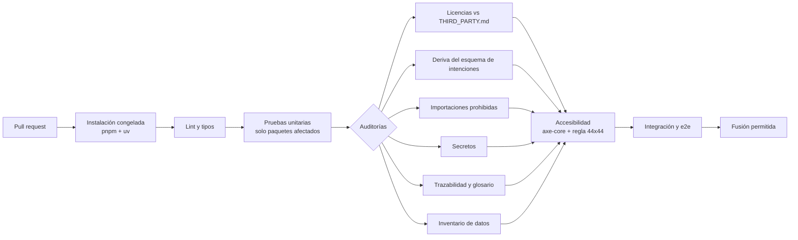
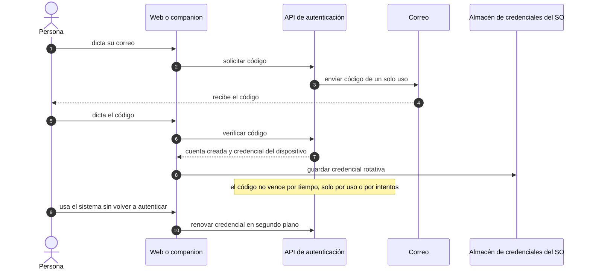
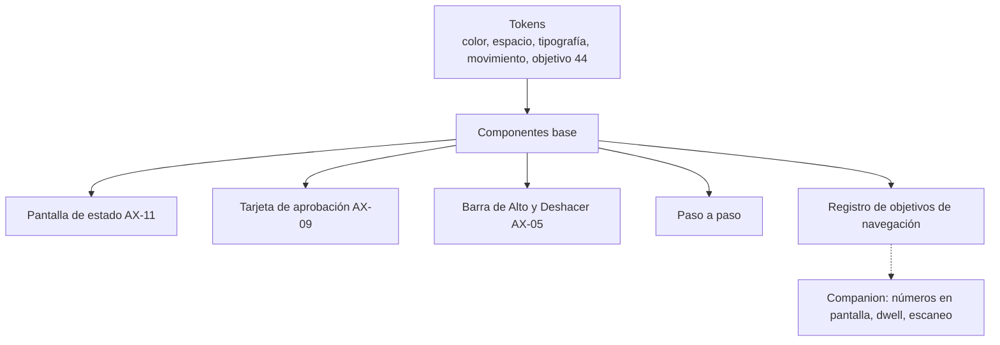

# Diseño: 00 Fundaciones

**Estado:** completo. Requisitos: `requirements.md` (REQ-00-001 a REQ-00-062).

## 1. Principios

1. Las reglas de la vertical se hacen cumplir **en la CI**, no solo en las revisiones.
2. La accesibilidad es una propiedad de los componentes, no de cada pantalla.
3. La autenticación no puede exigir manos, puntería ni tiempo.
4. Los registros técnicos no contienen contenido privado.

## 2. Monorepo y CI

**Auditorías propias** (scripts en `tools/audit/`, ejecutados por Turborepo):

| Script | Qué verifica | REQ |
| --- | --- | --- |
| `audit_licenses` | Cada dependencia está en `THIRD_PARTY.md` con licencia aprobada | 004 |
| `audit_schema_drift` | Los tipos generados desde `packages/intents` coinciden con los versionados | 003 |
| `audit_imports` | Sin red en `vision`/`voice`; sin cliente de base de datos de producción en `agents/`; sin HTTP saliente fuera de `gateway/` | 003 |
| `audit_secrets` | Sin secretos en el repositorio | 008 |
| `audit_traceability` | Cada REQ tiene tarea y prueba; sin términos prohibidos del glosario | 005 |
| `audit_data_inventory` | Todo campo nuevo está en el inventario de datos | spec 07 |
| `audit_copy` | Sin palabras prohibidas (SF-01) ni cadenas fijas fuera del catálogo | 011 |

Lista de **licencias aprobadas** [SUPUESTO]: MIT, BSD, Apache-2.0, ISC, MPL-2.0 (solo como dependencia sin modificar). **No aprobadas** en el artefacto distribuido: GPL, AGPL, LGPL sin revisión, EULA.

## 3. Autenticación sin manos

- **Emparejamiento de dispositivo:** el companion muestra un código corto; la web lo recibe por voz o por el cuidador/a (REQ-00-021). Sin vencimiento por tiempo; se invalida por uso, por generar otro o por exceder el número de intentos.
- **Sesión:** credencial por dispositivo con rotación; sin cierre por inactividad con trabajo pendiente (REQ-00-022).
- **Roles:** `person`, `caregiver`, `operator`, `company` (fase 2). El token lleva rol y alcances. `operator` no tiene alcances de lectura de contenido (REQ-00-024).
- **Limitación de intentos:** espera creciente, nunca bloqueo permanente (REQ-00-025).
- **Recuperación:** por correo y, si la persona lo autorizó, con ayuda de un cuidador/a.

**Modelo de datos mínimo**

| Tabla | Campos principales |
| --- | --- |
| `account` | `id`, `role`, `email` (cifrado), `language`, `created_at` |
| `device` | `id`, `account_id`, `label`, `paired_at`, `revoked_at` |
| `session` | `id`, `device_id`, `scopes`, `rotated_at`, `revoked_at` |
| `pairing_code` | `id`, `account_id`, `code_hash`, `attempts`, `used_at` (sin `expires_at`) |

## 4. Design system (`packages/ui`)

- **Tokens:** `target.min = 44` es un piso. Un tema que lo reduzca falla la prueba (REQ-00-040).
- **Componentes:** cada uno con estados normal, foco, activo, deshabilitado, error y cargando. Nombre accesible derivado de la etiqueta visible (REQ-00-042).
- **Sin vencimiento:** los avisos no se cierran solos (REQ-00-043).
- **Registro de objetivos de navegación:** cada control publica `{id, label, bounds}` para que la capa de entrada pueda numerarlo, activarlo por dwell o incluirlo en el escaneo (REQ-00-047).
- **Pantalla de estado:** recibe `{estado, qué pasó, acciones[], qué sigue funcionando[]}` (REQ-00-046).
- **Temas:** alto contraste, texto ampliable y movimiento reducido (REQ-00-045). El estilo visual lo definen después las skills de diseño, siempre subordinadas a `accessibility.md`.
- **Catálogo de componentes:** una herramienta de catálogo [SUPUESTO] con axe-core por componente y estado.

## 5. Errores, registros e i18n

- **Formato de error:** `{ code, message_es, recoverable, next_actions[] }` (REQ-00-009). Los mensajes los escribe un catálogo; se revisan que no culpen.
- **Depurador de registros:** una lista de campos de contenido (`text`, `body`, `dictation`, `profile`, `filename`, `recipient`) que se elimina antes de emitir el registro. Una prueba mete un texto de muestra y exige que no aparezca en la salida (REQ-00-010).
- **i18n:** catálogo `es` único; el lint falla ante cadenas visibles fijas (REQ-00-011).
- **Identificadores y tiempos:** biblioteca común (UUIDv7 `[SUPUESTO]`, tiempo monotónico y de reloj).

## 6. Decisiones y alternativas descartadas

| # | Decisión | Descartado | Por qué |
| --- | --- | --- | --- |
| D-00-1 | Autenticación sin contraseña con código y emparejamiento. | Contraseñas; passkeys con autenticador físico. | Las contraseñas exigen teclear con las manos; un autenticador físico exige tocarlo. |
| D-00-2 | Códigos sin vencimiento por tiempo, limitados por intentos. | Códigos de 10 minutos. | WCAG 2.2.6 y AX-03: no imponer plazos a la persona. |
| D-00-3 | Auditorías propias en la CI. | Solo revisión humana. | Los agentes de construcción cumplen lo que la CI les exige. |
| D-00-4 | `packages/ui` con un piso de 44 px no configurable. | Tamaño por tema. | AX-04 gana sobre el estilo. |
| D-00-5 | Un solo catálogo de textos en español. | Cadenas en cada componente. | Permite auditar lenguaje clínico y culpabilizante. |

## 7. Modelo de amenazas y qué ve cada parte

| Amenaza | Mitigación |
| --- | --- |
| Fuerza bruta sobre códigos | Intentos limitados con espera creciente, sin bloqueo permanente, aviso a la persona |
| Robo de la credencial del dispositivo | Almacén de credenciales del SO, rotación, revocación inmediata (REQ-00-023) |
| Operador lee contenido | Rol sin alcances de contenido (REQ-00-024); ver spec 07 |
| Filtración por registros | Depurador y prueba (REQ-00-010) |
| Dependencia con licencia incompatible | Auditoría de licencias (REQ-00-004) |

| Parte | Ve de la fundación |
| --- | --- |
| Persona | Sus dispositivos y sesiones |
| Cuidador/a | Su propia cuenta; los dispositivos de la persona si hay delegación |
| Operador | Cuentas como identificadores y roles; sin correo en claro ni contenido |
| Proveedor del modelo | Nada |
| Proveedor de nube y de correo | El correo de la cuenta para enviar códigos; tráfico cifrado |

## 8. Propiedades de corrección

| ID | Propiedad | REQ |
| --- | --- | --- |
| P-00-1 | Ningún fragmento de contenido de muestra aparece en los registros. | 010 |
| P-00-2 | Ningún componente puede renderizar un objetivo menor de 44×44 px CSS. | 040, 049 |
| P-00-3 | Ningún código de autenticación vence por tiempo. | 021 |
| P-00-4 | El rol `operator` no tiene alcances de lectura de contenido. | 024 |
| P-00-5 | Una dependencia no registrada o con licencia no aprobada rompe la CI. | 004 |
