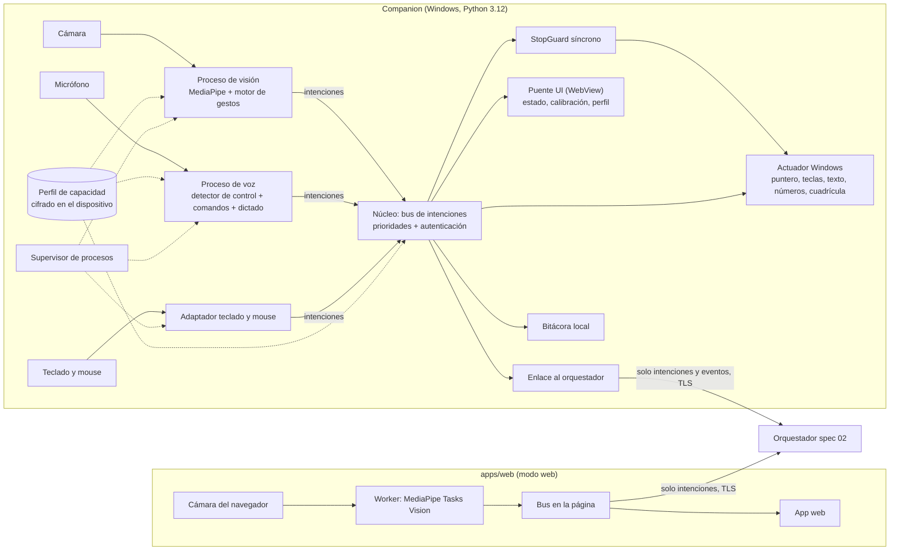
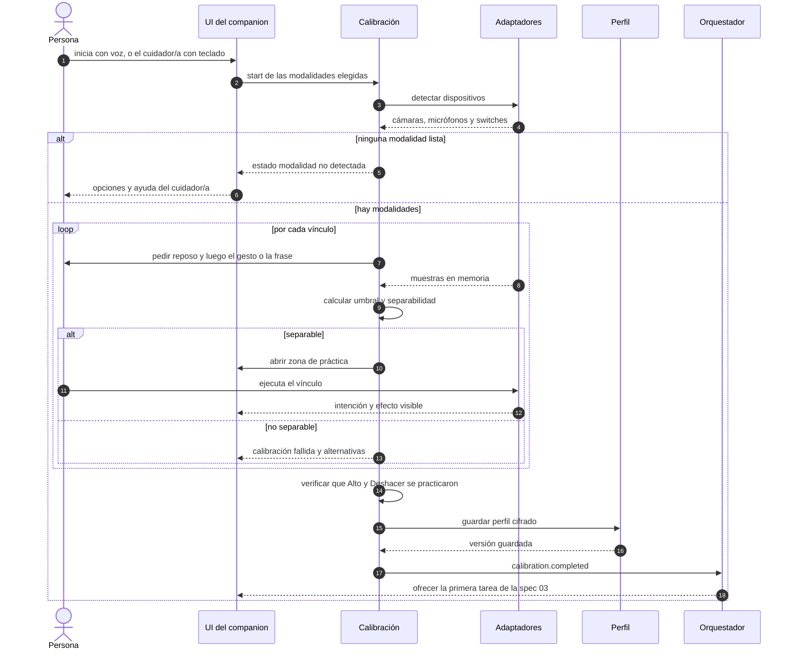
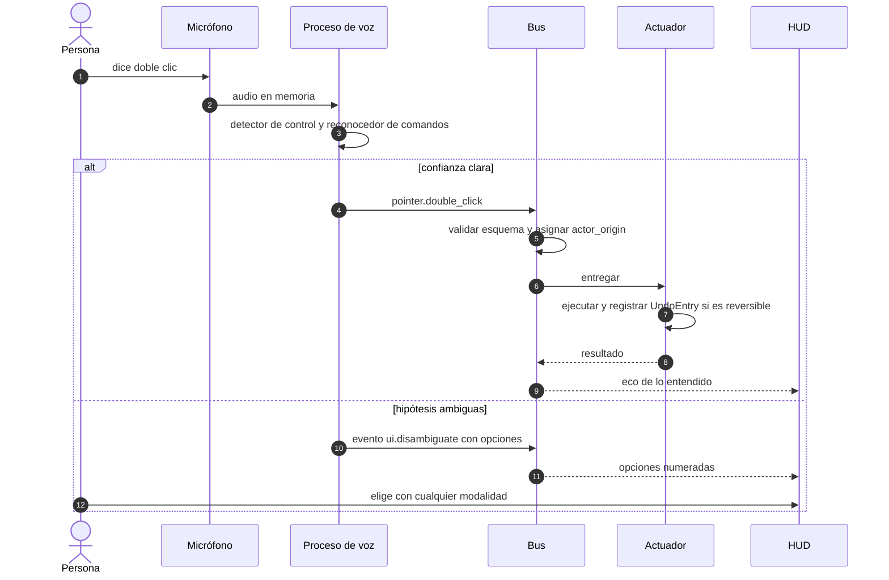
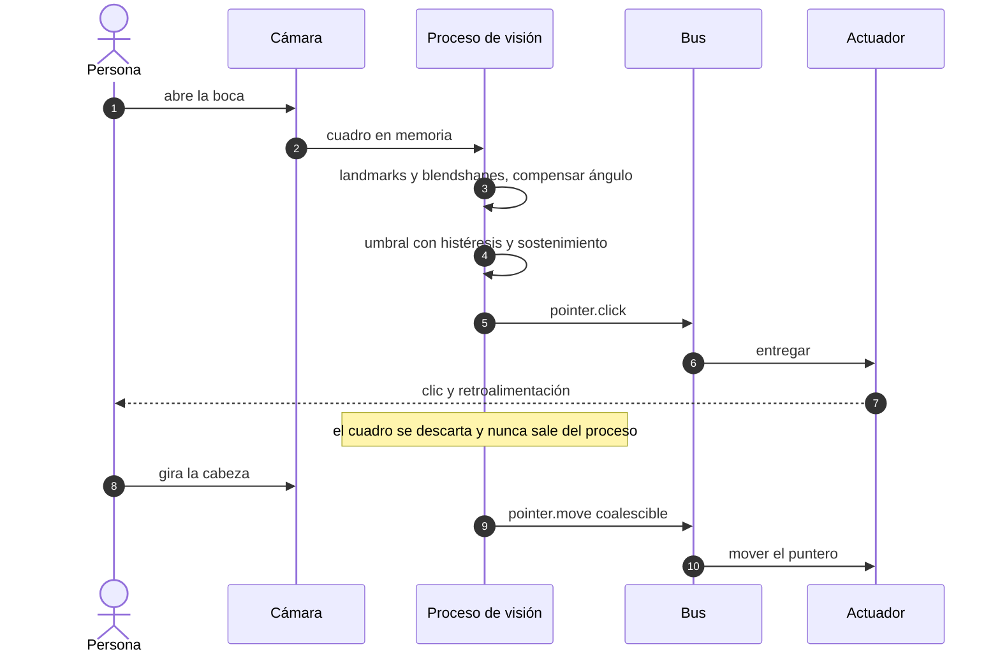
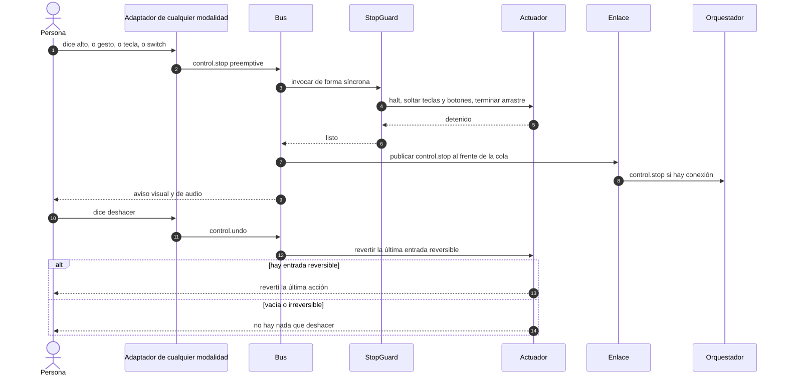

# Diseño: 01 Capa de entrada

**Estado:** completo. Requisitos: `requirements.md` (REQ-01-001 a REQ-01-157). Marcas: `[SUPUESTO]` y `[verificar]` como en el resto de las specs.

## 1. Objetivos y principios de diseño

1. **Una sola forma de decir las cosas.** Toda modalidad produce las mismas intenciones (REQ-01-003).
2. **Alto no depende de nadie.** El camino de Alto es síncrono, local y no pasa por la red ni por ningún modelo (REQ-01-018, 019).
3. **Los datos biométricos no salen.** Cámara y micrófono viven en procesos sin acceso a la red (REQ-01-044, 095).
4. **Falla cerrada en lo que importa.** Una aprobación dudosa no se emite; un perfil sin ruta de Alto no se guarda.
5. **Reproducible.** Cada adaptador acepta una fuente en vivo o una fixture y da la misma salida (REQ-01-015).
6. **Ampliable.** Mirada y switch se enchufan al mismo contrato sin tocar a los consumidores (REQ-01-014).

## 2. Arquitectura



**Procesos del companion**

| Proceso | Responsabilidad | Acceso a red |
| --- | --- | --- |
| `core` (bus, StopGuard, actuador, enlace) | Entrega de intenciones, Alto, ejecución en el SO, uplink | Solo el módulo de enlace, con lista permitida |
| `vision` | Cámara, landmarks, pose, gestos | Ninguno |
| `voice` | Micrófono, detector de control, comandos, dictado | Ninguno (la nube es un módulo aparte y opcional, REQ-01-096) |
| `kbm` | Teclado y mouse físicos | Ninguno |
| `ui` | WebView con `packages/ui` | Solo origen local |

El **supervisor** arranca los adaptadores como procesos hijos, les entrega una credencial efímera y los reinicia con espera creciente si caen (REQ-01-127).

## 3. Decisiones y alternativas descartadas

| # | Decisión | Alternativas descartadas | Por qué |
| --- | --- | --- | --- |
| D-01 | Cada adaptador en su **proceso**, comunicación por canal local autenticado. | Hilos en un solo proceso; un solo proceso monolítico. | Aísla la caída de la cámara o del modelo de voz (REQ-01-127) y permite prohibir la red a nivel de proceso (REQ-01-044). |
| D-02 | Canal local: **named pipe** de Windows con ACL a la cuenta de Windows actual y credencial efímera por sesión. | Socket TCP en loopback; archivos compartidos. | Otros procesos del mismo equipo no deben poder inyectar intenciones (REQ-01-012). Un pipe con ACL evita exponer un puerto. |
| D-03 | **Control de ritmo** de la cabeza (la inclinación fija una velocidad, con zona muerta) como modo por defecto, con modo de posición absoluta opcional. | Solo posición absoluta como Gameface. | Menos recorrido del cuello y menos fatiga `[SUPUESTO: validar con personas reales]`. |
| D-04 | Voz en **dos niveles**: nivel 1, reconocedor pequeño en streaming con gramática restringida (comandos, números, Alto, Deshacer, Ayuda); nivel 2, `faster-whisper` solo para dictado y se carga bajo demanda. | Whisper para todo; solo Whisper en la nube. | Los comandos y Alto deben cumplir un presupuesto bajo de latencia (REQ-01-139, 142) `[verificar en hardware real, PA-10]`. La nube viola V-06 por defecto. |
| D-05 | Detector de **palabras de control** (Alto, Deshacer, Ayuda) separado y siempre activo, con umbral más permisivo. | Usar el mismo reconocedor que los comandos. | Prioriza no perder un Alto sobre evitar un falso Alto (REQ-01-154); un falso Alto es barato. |
| D-06 | Archivos de comandos en **YAML** validado con JSON Schema, inspirados en `.talon`. | Embeber Talon (EULA); inventar un DSL propio. | V-10 prohíbe embeber el núcleo de Talon; YAML reduce el costo de parser y validación. |
| D-07 | Actuador sobre **UI Automation** de Windows para números en pantalla e imán, y **cuadrícula** como respaldo. | Reconocimiento visual (OCR) como vía principal. | UI Automation da elementos accionables con nombre; la cuadrícula cubre lo que no expone (REQ-01-061, 062, 064). |
| D-08 | Entrada de teclado/mouse con **atajos globales** para Alto, Deshacer y Ayuda configurables. | Sin atajos globales. | Ruta de Alto inmediata para cuidadores/as y para la persona con movilidad parcial (REQ-01-057). |
| D-09 | **Voz sintética** del sistema operativo (Windows) por defecto; Piper opcional una vez resuelta su licencia (PA-09); ElevenLabs solo con consentimiento. | Piper por defecto. | Evita incorporar GPL en el artefacto (REQ-01-151). |
| D-10 | El **perfil de capacidad** vive solo en el dispositivo en el MVP (sin sincronización). | Sincronizarlo con el servidor cifrado. | Mínima exposición de datos de categoría especial (S-11). REQ-01-085 sigue vigente para cuando se active la sincronización. |
| D-11 | **Un solo esquema** JSON (`packages/intents`) que genera tipos Python y TypeScript. | Dos definiciones a mano. | REQ-01-002. |
| D-12 | UI del companion como **WebView** con `packages/ui`. | Toolkit de escritorio nativo (Qt, Tk). | Permite aplicar axe-core y las reglas AX a las mismas pantallas (S-07). |
| D-13 | **Un falso Alto es aceptable; un Alto perdido no.** | Umbral único. | SP-2. |
| D-14 | El **modo web** controla solo la app web, no el sistema operativo. | Extensión de navegador que controle todo. | Límite de seguridad del navegador y del alcance (REQ-01-055). |

## 4. Modelo de datos mínimo

### 4.1 Intención (`packages/intents/schema/intent.schema.json`)

```json
{
  "id": "0192f3c4-...-uuidv7",
  "type": "pointer.click",
  "modality": "head_gesture",
  "adapter": "vision@1.0.0",
  "actor_origin": "person",
  "monotonic_ts": 1834200123,
  "wall_ts": "2026-11-14T15:04:05.123Z",
  "confidence": 0.93,
  "priority": "normal",
  "payload": { "button": "left" }
}
```

- `actor_origin` lo rellena el núcleo desde la sesión del adaptador (REQ-01-007).
- `approval.*` añade `pending_action_id` y `content_digest` obligatorios (REQ-01-010).
- `priority` se deriva del `type` (REQ-01-005); el adaptador no la elige.
- `text.dictation` lleva `payload.text` y `payload.final`. El texto no se registra en la bitácora (REQ-01-013).

### 4.2 Perfil de capacidad (`packages/intents/schema/capability-profile.schema.json`)

```json
{
  "schema_version": 1,
  "profile_id": "en-cama",
  "label": "En cama",
  "language": "es-EC",
  "modalities": {
    "voice":   { "enabled": true,  "gain": 1.8, "isolation_silence_ms": 400, "ambiguity_margin": 0.15 },
    "head_gesture": {
      "enabled": true, "pointer_mode": "rate", "dead_zone": 0.08, "max_speed": 0.6,
      "tremor_filter": false, "camera_roll_deg": 12, "neutral_pose": {"yaw": 0.0, "pitch": -0.05},
      "gestures": { "mouth_open": { "on": 0.55, "off": 0.35, "hold_ms": 250, "cooldown_ms": 600 } }
    },
    "keyboard_mouse": { "enabled": true }
  },
  "bindings": [
    { "trigger": { "gesture": "mouth_open" }, "intent": "pointer.click" },
    { "trigger": { "phrase": "alto" }, "intent": "control.stop" }
  ],
  "approval_min_confidence": 0.85,
  "min_target_px": 44,
  "feedback": { "visual": true, "audio": true },
  "declared_condition": null
}
```

Los valores numéricos son ejemplos. **Invariantes** que valida el esquema y el código: cada modalidad habilitada tiene un disparador de `control.stop` y de `control.undo` (REQ-01-016); `declared_condition` solo existe si la persona lo declaró (REQ-01-084); `min_target_px ≥ 44`.

### 4.3 Archivo de comandos de voz (`commands/*.commands.yaml`)

```yaml
version: 1
context: { app: ["chrome", "msedge"], mode: command }   # opcional
captures:
  numero: { kind: spoken_number, lang: es }
commands:
  - say: "clic"
    intent: { type: pointer.click, button: left }
  - say: "doble clic"
    intent: { type: pointer.double_click }
  - say: "número <numero>"
    intent: { type: ui.select_target, by: number, value: "{numero}" }
```

Un archivo no puede definir intenciones `approval.*`, `control.*` ni `help.*`: esas vienen del conjunto base y no se sobrescriben (REQ-01-036).

### 4.4 Otras estructuras

| Estructura | Campos principales |
| --- | --- |
| `UndoEntry` | `id`, `kind` (`text_insert`, `drag_toggle`, `mode_set`, `profile_change`), `revert()`, `reversible` |
| `StopState` | `stop_reachable`, `routes: [{modality, healthy, reason}]`, `updated_at` |
| `CalibrationRecord` | `modality`, `binding`, `threshold`, `separability`, `completed_at`, `version`. **Sin muestras crudas** (REQ-01-082) |
| `FixtureManifest` | `kind` (landmarks, audio), `fps` o `sample_rate`, `model_version`, `synthetic` o `consent_ref` |
| `AdapterHealth` | `adapter`, `status`, `last_heartbeat`, `device` |

## 5. Secuencias

### 5.1 Calibración y paso a la primera tarea



### 5.2 Voz → intención → acción



### 5.3 Gesto → intención → acción



### 5.4 Alto y Deshacer



## 6. Algoritmos y reglas [SUPUESTO en parámetros; se afinan con las fixtures y el benchmark]

**Cabeza → puntero (REQ-01-045, 046, 052, 157)**

1. De cada cuadro se toma la pose de la cabeza (guiñada y cabeceo) desde la matriz de transformación facial de MediaPipe.
2. Se resta la pose neutral del perfil y se corrige la inclinación de la cámara (`camera_roll_deg`).
3. Modo `rate` (por defecto): fuera de la zona muerta, la velocidad del puntero crece con la desviación hasta `max_speed`. Modo `absolute`: la pose se mapea a la pantalla.
4. Filtro de suavizado adaptativo (One Euro u otro equivalente) con los parámetros del perfil. El filtro de temblor limita aceleración y salto.
5. «Centrar» reemplaza la pose neutral por la pose actual sin tocar los gestos.

**Gestos (REQ-01-047 a 049)**

- Puntaje por gesto = blendshape (o combinación) suavizado. Máquina de estados: `IDLE → ARMED` cuando el puntaje supera `on`; `ARMED → ACTIVE` tras `hold_ms` sostenido; `ACTIVE → IDLE` cuando cae bajo `off` (con `off < on`); luego `cooldown_ms`.
- Ningún gesto depende de otro ni de una ventana de tiempo entre dos gestos. Doble clic y arrastre son intenciones únicas.

**Calibración de umbrales (REQ-01-072, 075)**

- Se capturan muestras en reposo y con el gesto. Si el percentil bajo de las muestras activas no supera el percentil alto del reposo, el gesto es **no separable** y se declara «calibración fallida».
- Si es separable, `on` se coloca entre ambos con un margen y `off` por debajo de `on`. Se mide el reposo después con el umbral puesto (activaciones involuntarias).
- Los valores crudos se descartan al terminar (REQ-01-082).

**Voz**

- Nivel 1: reconocedor en streaming con gramática restringida. Si dos hipótesis quedan a menos de `ambiguity_margin`, no se ejecuta ninguna (REQ-01-031).
- Detector de control: umbral permisivo para Alto, Deshacer y Ayuda. En dictado, el detector exige que el enunciado quede aislado por `isolation_silence_ms` de silencio por ambos lados (REQ-01-021).
- Nivel 2 (dictado): `faster-whisper` en segmentos. Formato hablado (coma, punto, nueva línea) se interpreta con reglas en español (REQ-01-039).

**Actuador (REQ-01-060 a 068)**

- Cada primitiva (mover, pulsar, escribir) comprueba una bandera atómica de parada. `halt()` la activa, suelta teclas y botones pulsados y termina el arrastre.
- Números en pantalla: recorrido de UI Automation de la ventana activa, filtrado a elementos accionables y orden por lectura. Superposición transparente que no captura el puntero. Si la aplicación no expone elementos, se ofrece cuadrícula (rejilla de 3×3 que se refina [SUPUESTO]).
- Imán: el elemento accionable más cercano dentro de un radio configurable.
- Clases de actuación y reversibilidad (REQ-01-024): inserción de dictado (reversible si el foco y el campo no cambiaron), arrastre (alternancia), cambio de modo y de perfil (reversibles); teclas y clics en aplicaciones de terceros (**no** reversibles, se dice con claridad).
- Solo se aceptan solicitudes del bus (REQ-01-067). El actuador no expone ninguna otra interfaz.

## 7. Interfaces

**Contrato del adaptador** (REQ-01-014)

```
Adapter:
  id, version, modality
  start(profile, source)        # source = live | fixture
  stop()
  health() -> AdapterHealth
  emits: Intent | Event(ui.disambiguate | input.health)
```

**Bus (núcleo)**

```
publish(intent)                 # solo adaptadores registrados (REQ-01-012)
subscribe(types, consumer)      # actuador, UI, enlace, bitácora local
state: StopState                # stop_reachable (REQ-01-026, 129)
```

**Enlace al orquestador:** WebSocket sobre TLS. Envía solo intenciones, latidos y eventos del esquema (REQ-01-095). El orquestador responde con eventos de UI (solicitudes de aprobación, estados), nunca con órdenes de actuación sobre el sistema operativo (REQ-01-067).

**Puente UI:** mensajes JSON entre el núcleo y el WebView para estado de modalidades, calibración, perfil, ayuda de comandos y dictado.

**Eventos internos que no son intenciones:** `ui.disambiguate`, `input.health`, `stop.state`, `heartbeat`, `calibration.completed`.

## 8. Modelo de amenazas

| # | Amenaza | Mitigación | REQ |
| --- | --- | --- | --- |
| A-01 | Un proceso local inyecta intenciones, en especial aprobaciones. | Named pipe con ACL a la cuenta de Windows, credencial efímera por adaptador, `actor_origin` desde la sesión. | 007, 008, 012 |
| A-02 | Exfiltración de cuadros, audio o landmarks. | Procesos de visión y voz sin red, lista permitida de egreso, CSP estricta y modelo propio en la web, pruebas de captura de red. | 044, 055, 095 |
| A-03 | Aprobación por reconocimiento erróneo. | Umbral de confianza del perfil, falla cerrada, aprobación atada a `pending_action_id` y `content_digest`. | 010, 011, 155 |
| A-04 | Archivo de comandos malicioso (de un cuidador/a o de terceros). | El archivo solo puede emitir intenciones del catálogo; no puede definir `approval.*`, `control.*` ni `help.*`; no hay intención que lance programas en el MVP. | 028, 036 |
| A-05 | Saturar el bus para ocultar o retrasar Alto. | Prioridad `preemptive`, StopGuard síncrono antes de encolar. | 005, 006, 018 |
| A-06 | Repetir una aprobación antigua. | Sello de un solo uso y atado al contenido (spec 02). | 010 |
| A-07 | Robo del perfil de capacidad. | Cifrado en reposo con clave del sistema operativo; sin sincronización en el MVP. | 085 |
| A-08 | Un cuidador/a se hace pasar por la persona. | Sesiones separadas; el origen sale de la sesión autenticada; sin delegación vigente no hay aprobación. | 007, 059 |
| A-09 | Fixtures con datos biométricos reales. | `manifest.json` con `synthetic` o `consent_ref`, auditoría en CI. | 100 |
| A-10 | Voz en la nube activada sin querer. | Apagada por defecto, consentimiento explícito, indicador persistente. | 096 |
| A-11 | Un agente intenta manejar el PC por el actuador. | El actuador solo escucha al bus. | 067 |

### Qué ve cada parte de la capa de entrada

| Parte | Ve | No ve |
| --- | --- | --- |
| Persona | Todo lo suyo en el dispositivo: estado, perfil, calibración, bitácora local. | Nada que no sea suyo. |
| Cuidador/a | Según la delegación: estado de dispositivos y, con `profile.edit`, el perfil. | Cuadros, audio, landmarks; la condición declarada. |
| Operador | Métricas técnicas sin contenido (versiones, errores, latidos). | Perfiles, calibraciones, dictados, bitácora de contenido. |
| Proveedor del modelo | Solo el texto de tareas que le envíe la spec 02 con consentimiento. | Perfil, calibración, cuadros, audio. |
| Proveedor de nube (hosting) | Intenciones y eventos en tránsito (TLS) y los datos que guarde la spec 07. | Cuadros, audio, landmarks. |
| Proveedor de voz en la nube (opcional) | El audio **solo si** la persona activó ese consentimiento. | Nada si no hay consentimiento. |

## 9. Propiedades de corrección

| ID | Propiedad | Cómo se verifica |
| --- | --- | --- |
| P-01-1 | Alto siempre detiene: tras `control.stop`, en cualquier modo y con cualquier actuación en curso, no queda ninguna primitiva en ejecución ni tecla o botón pulsado. | Prueba basada en propiedades sobre combinaciones de modo y actuación. REQ-01-018, 020. |
| P-01-2 | Ningún cuadro, audio ni landmark sale del dispositivo. | Captura de red en el companion y en el modo web, auditoría de importaciones. REQ-01-044, 055, 095. |
| P-01-3 | Ninguna `approval.approve` con `actor_origin = system`, ni con confianza bajo el umbral. | Pruebas del bus y fixtures de ruido. REQ-01-008, 011, 155. |
| P-01-4 | La misma fixture, perfil y modelo producen la misma secuencia de intenciones. | Pruebas de reproducción. REQ-01-015. |
| P-01-5 | `stop_reachable` es veraz: nunca verdadero sin una ruta de Alto sana. | Pruebas con fallos inyectados. REQ-01-026, 129. |
| P-01-6 | Todo perfil guardado tiene Alto y Deshacer en cada modalidad habilitada. | Prueba de invariante. REQ-01-016. |
| P-01-7 | Una intención `preemptive` nunca se descarta ni se entrega después de una `normal` que entró antes. | Prueba de orden del bus. REQ-01-005, 006. |
| P-01-8 | Deshacer nunca revierte una acción declarada irreversible. | REQ-01-023, 024. |
| P-01-9 | Ninguna función requiere doble clic, arrastre sostenido ni ventana de tiempo entre gestos. | Revisión estática del catálogo y de los vínculos. REQ-01-049. |
| P-01-10 | `actor_origin` no puede ser fijado por la carga útil. | REQ-01-007. |

## 10. Estrategia de pruebas

- **Fixtures** (`apps/companion/tests/fixtures/{landmarks,audio}/`): reposo, estrés, por gesto, por ángulo (sentado, reclinado, acostado), voz baja, ruido, por comando y por modo de voz. Generadas de forma sintética primero (REQ-01-100).
- **Arnés de reproducción** que alimenta cada adaptador y compara la secuencia de intenciones.
- **Arnés de rendimiento** que mide los p95 de REQ-01-137 a 144 y el uso de CPU y memoria de REQ-01-146 a 148.
- **Playwright** para el modo web y las pantallas del companion (WebView); **axe-core** más la regla de 44×44.
- **Actuador:** aplicaciones de muestra (una nativa, una Chromium) para números, cuadrícula e imán.

## 11. Cambios al stack respecto de `tech.md`

| Cambio | Justificación |
| --- | --- |
| Voz sintética del sistema como valor por defecto, Piper opcional. | Licencia de Piper activo (GPL-3.0, PA-09). |
| Perfil solo local en el MVP. | Minimizar datos de categoría especial (S-11). |
| Voz en dos niveles. | Latencia de comandos y Alto (D-04). |
| Archivos de comandos en YAML. | D-06. |

## 12. Riesgos y pendientes para la construcción

- Elegir y medir el reconocedor de nivel 1 en el hardware real `[verificar]` (PA-10). Tarea con benchmark temprano.
- Cobertura de UI Automation en aplicaciones Chromium y Electron (requieren accesibilidad activada).
- Ajuste de umbrales y de la regla de aislamiento de Alto con fixtures de voz de personas con volumen bajo (REQ-01-156).

