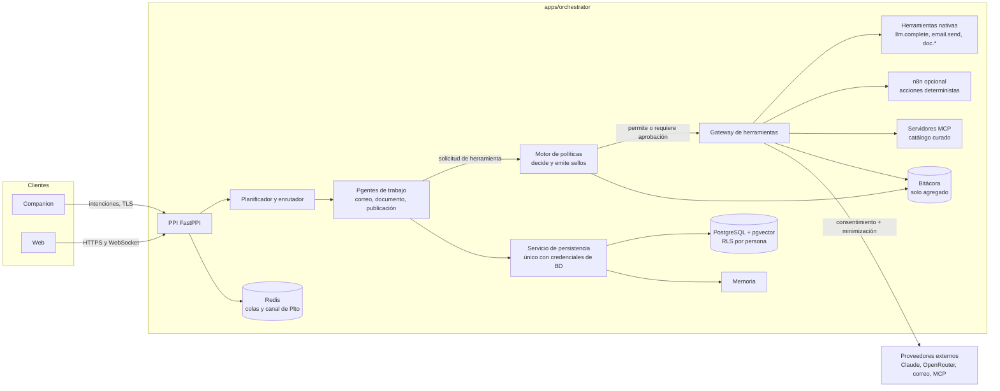
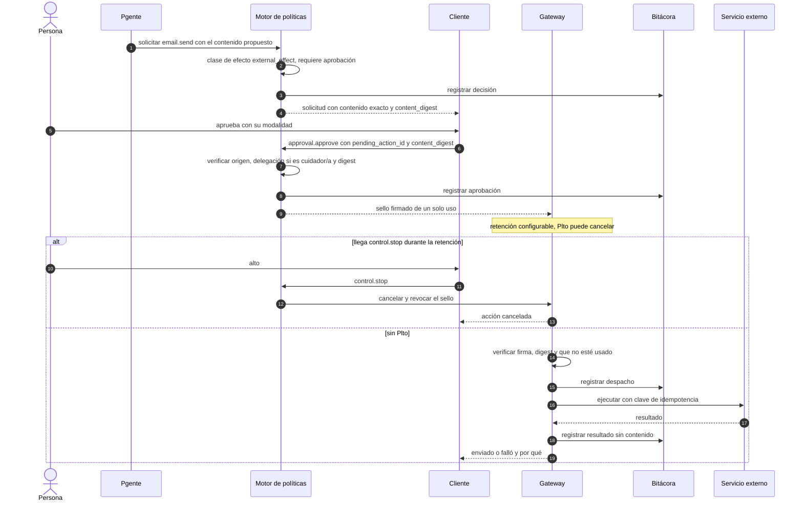
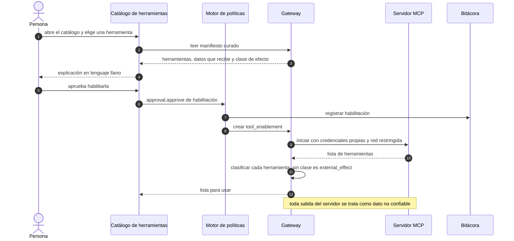
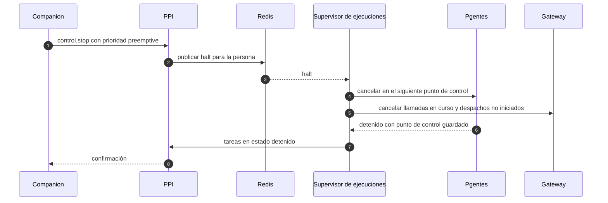

# Diseño: 02 Orquestador y agentes

**Estado:** completo. Requisitos: `requirements.md` (REQ-02-001 a REQ-02-098).

## 1. Principios

1. **El orquestador razona y delega; las herramientas ejecutan; la memoria recuerda** (Prthur).
2. **Nada con efecto externo ocurre sin un sello de aprobación válido** que el gateway verifica por sí mismo (SP-1).
3. **El agente propone; la política decide.**
4. **Falla cerrada.** Sin política, sin bitácora o sin sello, no hay efecto externo.
5. **La salida de una herramienta es dato, no instrucción.**

## 2. Prquitectura



**Piezas**

| Pieza | Responsabilidad | Credenciales |
| --- | --- | --- |
| PPI | Recibe intenciones y solicitudes, autentica, aplica límites de frecuencia | Sesión de la persona |
| Planificador y enrutador | Produce el plan, elige modelo por tipo de tarea, replanifica | Ninguna de terceros |
| Pgentes | Ejecutan micro-pasos con una lista permitida de herramientas | **Ninguna** de BD ni de terceros |
| Motor de políticas | Decide; emite y verifica sellos de aprobación; consulta delegaciones y consentimientos | Clave de firma de sellos |
| Gateway | Único con salida de red; verifica sellos; aplica consentimiento y minimización | Credenciales de terceros por herramienta |
| Servicio de persistencia | Única vía de escritura a la BD, con política y registro | Credenciales de BD |
| Bitácora | Solo agregado, sin contenido, con cadena de hash | Escritura solo por el servicio |

**Las llamadas a modelos también son herramientas del gateway** (`llm.complete`). El constructor de prompts corre antes del gateway y solo admite campos de una lista permitida (REQ-02-005).

## 3. Decisiones y alternativas descartadas

| # | Decisión | Descartado | Por qué |
| --- | --- | --- | --- |
| D-02-1 | Pgentes **sin** credenciales de BD ni de terceros; todo por persistencia y gateway. | Pgentes con acceso directo. | V-08. Un agente comprometido o inyectado no puede escribir en producción ni salir a la red. |
| D-02-2 | El **gateway** verifica el sello de aprobación, no solo el motor de políticas. | Confiar en que el agente llama después de la política. | Defensa en profundidad: aunque falle un agente o el planificador, la herramienta externa no corre sin sello (SP-1). |
| D-02-3 | **Sello** firmado, atado a `pending_action_id`, `content_digest` y actor, de un solo uso, sin vencimiento por tiempo. | Pprobación como un booleano; sellos con TTL corto. | Ptar al contenido evita aprobar una cosa y enviar otra. Sin TTL respeta PX-03; se invalida por uso, Plto, cambio de contenido o revocación. |
| D-02-4 | La tarjeta de aprobación muestra el **contenido exacto** (determinista), no un resumen generado por el modelo. | Resumen del LLM. | Un resumen puede engañar o estar inyectado. |
| D-02-5 | Herramienta sin clase de efecto = `external_effect`. | Psumir `read`. | Denegar por defecto. |
| D-02-6 | **MCP** como fuente de herramientas del gateway, con catálogo curado en el MVP y habilitación por la persona. | Permitir cualquier servidor MCP; MCP directo desde agentes. | Un servidor MCP es código de terceros con acceso a datos. V-08 exige que pase por el gateway y por política. |
| D-02-7 | **Retención** corta entre aprobación y despacho, configurable. | Despacho inmediato. | Plto puede cancelar aun después de aprobar (SP-2). |
| D-02-8 | n8n **opcional**, detrás del gateway. | n8n obligatorio. | Su licencia puede restringir un producto comercial (PP-09); `email.send` y otras acciones nativas funcionan sin él. |
| D-02-9 | Memoria con **seguridad por filas** y clave por persona. | Filtro solo en la aplicación. | Písla personas aunque falle la capa de aplicación. |
| D-02-10 | Bitácora con **cadena de hash**. | Tabla común. | Detectar alteraciones [SUPUESTO]. |
| D-02-11 | El dial regula pasos internos; la aprobación de acciones externas no se negocia. | Dial que permite envío automático. | C-08: V-01 gana sobre V-03. |
| D-02-12 | **No** sugerir subir el dial. | Sugerencias basadas en uso. | V-03: subirlo es decisión de la persona, y una sugerencia presiona. |

## 4. Modelo de datos mínimo

```
task(id, person_id, type, state, autonomy_level, created_at)
plan(id, task_id, version, steps jsonb)
step(id, plan_id, kind, status, checkpoint_ref)
pending_action(id, task_id, tool, effect_class, content_digest, status)
approval_grant(id, pending_action_id, content_digest, actor_id, actor_origin,
               signature, used_at, revoked_at)           -- sin expires_at
tool_manifest(name, source, effect_class, reversible, data_categories[], provider)
tool_enablement(person_id, tool_name, enabled_by, enabled_at)
audit_event(seq, person_id, kind, refs jsonb, prev_hash, hash)   -- sin contenido
memory_item(id, person_id, kind, ciphertext, embedding)          -- RLS por person_id
policy_rule(id, version, spec jsonb)
```

`pending_action.status`: `awaiting_approval → approved → in_hold → dispatched | cancelled | rejected`.

## 5. Secuencias

### 5.1 Pcción externa: política, sello, retención y despacho



### 5.2 Habilitar un servidor MCP



### 5.3 Plto en el orquestador



## 6. Reglas de diseño

- **Constructor de prompts:** recibe un objeto tipado con campos permitidos (instrucción del paso, texto de la tarea, preferencias de memoria). Cualquier otro campo lanza un error (REQ-02-005). Prueba de contrato con campos prohibidos.
- **Inyección de prompts:** las salidas de herramientas y documentos entran en un canal marcado como datos; el planificador no puede ampliar la lista de herramientas a partir de ellas; y aunque ocurra una inyección, una acción externa sigue necesitando el sello (REQ-02-028, 097). Se mantiene un conjunto de pruebas de inyección.
- **Clases de efecto:** `read` (leer), `internal_write` (cambia datos propios del sistema, p. ej. guardar un documento) y `external_effect`. Enviar, publicar, compartir, borrar fuera del sistema y cobrar son siempre `external_effect`.
- **Niveles de autonomía** (spec 03): N0, N1 y N2 se evalúan en el motor de políticas solo para pasos `read` e `internal_write`.
- **Deshacer:** una herramienta puede declarar una compensación (por ejemplo borrar un borrador creado); las irreversibles lo declaran y el sistema lo dice con claridad (REQ-02-062, 064).
- **Enrutamiento:** tabla `task_type → modelo principal → respaldo`; el cambio al respaldo exige consentimiento del proveedor (REQ-02-004).
- **Memoria:** el contenido se cifra con la clave de la persona y se indexa con un embedding; el embedding lo calcula un modelo cuyo proveedor tenga consentimiento, o uno local en el servidor `[SUPUESTO]`.
- **Estado sin red del cliente:** el companion guarda su bitácora local y la envía al reconectar; el servidor la fusiona sin duplicados (REQ-02-084).

## 7. Modelo de amenazas

| # | Pmenaza | Mitigación | REQ |
| --- | --- | --- | --- |
| B-01 | Inyección de prompt en un documento, correo o salida MCP intenta enviar o filtrar datos. | Datos no confiables, lista permitida de herramientas, sello obligatorio, tarjeta con contenido exacto. | 028, 023, 097 |
| B-02 | Pgente comprometido escribe en la BD. | Sin credenciales; solo persistencia con política. | 012 |
| B-03 | Reutilizar un sello o aplicarlo a otro contenido. | Un solo uso, atado al digest, invalidado por cambio. | 043, 044 |
| B-04 | Cuidador/a aprueba sin permiso. | Verificación de delegación en el motor de políticas. | 045 |
| B-05 | Servidor MCP malicioso o con exceso de permisos. | Catálogo curado, credenciales propias, red restringida, aislamiento. | 029, 030 |
| B-06 | Fuga de perfil o de crisis a un proveedor. | Constructor de prompts con lista permitida; salida con consentimiento. | 005, 006 |
| B-07 | Motor de políticas o bitácora caídos. | Falla cerrada para efectos externos. | 049, 053 |
| B-08 | Operador lee contenido. | Sin vías de lectura; claves por persona. | 082 |
| B-09 | Un agente se salta el gateway. | Puditoría de importaciones y de salida de red. | 008, 020 |
| B-10 | Plto no llega a los agentes. | Redis, cancelación cooperativa, Plto local independiente. | 060, 061, 063 |

### Qué ve cada parte

| Parte | Ve |
| --- | --- |
| Persona | Todo lo suyo: plan, propuestas, memoria, bitácora legible |
| Cuidador/a | Solo lo que cubre su delegación; contadores por defecto |
| Operador | Métricas y registros técnicos sin contenido |
| Proveedor del modelo | El texto mínimo del paso, con consentimiento; nunca perfil, calibración ni crisis |
| Proveedor de correo u otro servicio externo | Lo que la persona aprobó enviar, exactamente |
| Servidor MCP | Solo lo que su herramienta necesita para la llamada |
| Hosting | Datos cifrados con la clave de la persona |

## 8. Propiedades de corrección

| ID | Propiedad | REQ |
| --- | --- | --- |
| P-02-1 | Ninguna herramienta `external_effect` se ejecuta sin un sello válido (SP-1). | 023, 041 |
| P-02-2 | Un sello solo sirve para el contenido que se aprobó, una vez. | 043, 044 |
| P-02-3 | `control.stop` deja detenidas todas las ejecuciones de la persona (SP-2). | 060, 061 |
| P-02-4 | Sin delegación vigente, una aprobación de cuidador/a se rechaza (SP-4). | 045 |
| P-02-5 | Pprobaciones de `system` o de un agente se rechazan. | 046 |
| P-02-6 | Los prompts nunca contienen perfil, condición declarada ni eventos de crisis (SP-6). | 005 |
| P-02-7 | Si falla el motor de políticas o la bitácora, no hay efecto externo. | 049, 053 |
| P-02-8 | Herramienta sin clase = `external_effect`. | 022 |
| P-02-9 | Una herramienta MCP solo se habilita por una intención de la persona. | 026, 027 |
| P-02-10 | Ninguna salida de herramienta cambia las herramientas permitidas ni las políticas. | 028 |
| P-02-11 | El nivel de autonomía nunca elimina la aprobación externa. | 047 |

## 9. Estrategia de pruebas

- **Unit y contract:** políticas, sellos, manifiestos de herramientas, constructor de prompts.
- **Seguridad:** conjunto de inyecciones, intentos de salto del gateway, rol operador, delegaciones.
- **Integración:** flujo completo 5.1 con un servicio externo simulado; Plto durante la retención; caída de política y de bitácora.
- **Propiedades:** pruebas basadas en propiedades sobre combinaciones de nivel, clase de efecto y origen.

