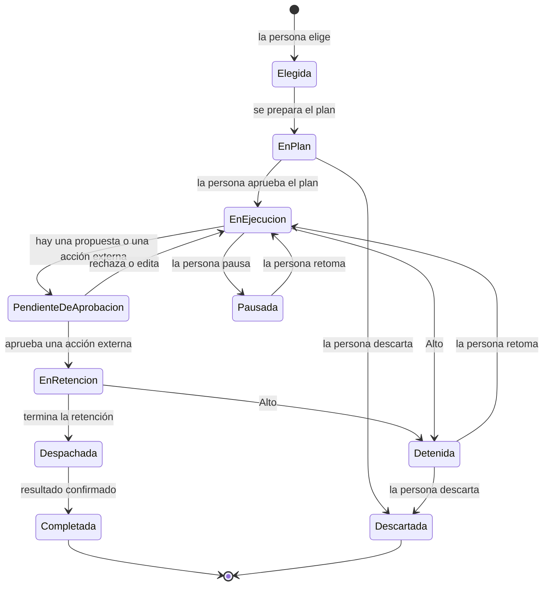
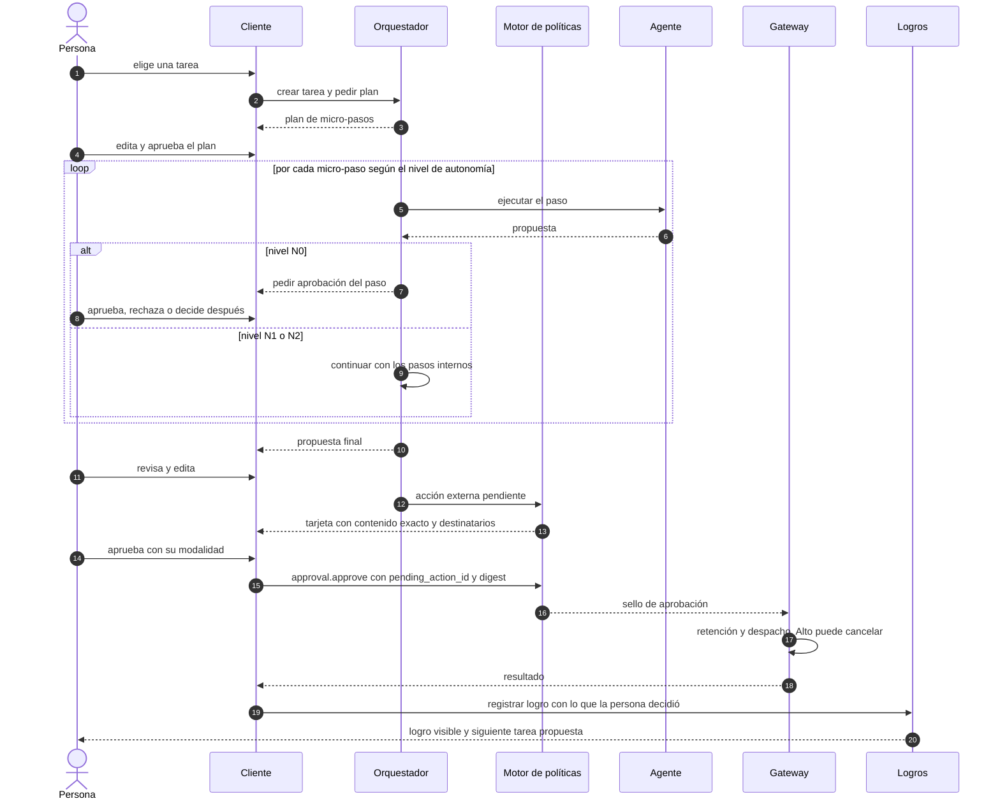
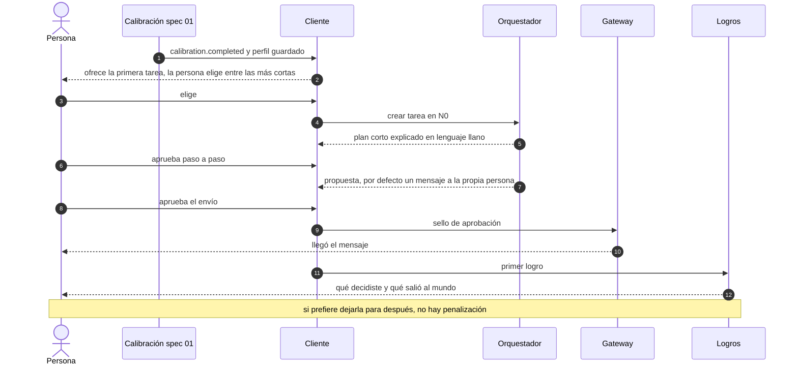

# Diseño: 03 Ciclo de control

**Estado:** completo. Requisitos: `requirements.md` (REQ-03-001 a REQ-03-063).

## 1. Principios

1. **La persona elige, revisa y aprueba.** El sistema puede proponer; no inicia ni decide.
2. **El control se vive.** Cada sesión termina con algo que la persona hizo y que tuvo un efecto visible.
3. **El progreso solo suma.** Sin rachas, sin pérdidas, sin reproches (AX-13, SF-02).
4. **Nada expira.** Una aprobación pendiente, una tarea pausada y una tarea detenida esperan.

## 2. Máquina de estados de una tarea



Solo la persona (o su cuidador/a con `tasks.start`) mueve la tarea fuera de `Detenida` o `Pausada`. Ninguna transición ocurre por tiempo.

## 3. Secuencia: tarea con aprobación



## 4. Secuencia: primera tarea en la sesión 1



## 5. Modelo de datos mínimo

```
task_type(id, label_es, tools[], min_steps)
task(id, person_id, type, state, autonomy_level, created_by, created_at)
step(id, task_id, order, label_es, status)
autonomy_setting(person_id, task_type, level, changed_by, changed_at)
achievement(id, person_id, task_id, task_type, completed_at, decisions jsonb)   -- sin contenido
approval_event(id, task_id, pending_action_id, actor_origin, decision, at)
```

- `decisions` de un logro: lista de decisiones propias (aprobó el plan, aprobó el envío, rechazó una variante). No guarda texto de la tarea.
- `created_by` distingue persona y cuidador/a con delegación.

## 6. Reglas de diseño

**Dial de autonomía (REQ-03-021 a 026).** Una tabla de política (spec 02) mapea nivel y clase de efecto a la acción:

| Clase de efecto | N0 | N1 | N2 |
| --- | --- | --- | --- |
| `read` | pide aprobación del paso | ejecuta | ejecuta |
| `internal_write` | pide aprobación del paso | ejecuta, aprueba la propuesta final | ejecuta, aprueba el paquete final |
| `external_effect` | aprobación | aprobación | aprobación (una vez, con vista previa del paquete) |

Subir de nivel pide una aprobación que explica lo que cambia; bajar es inmediato. El sistema no sugiere subir (REQ-03-023).

**Siguiente tarea (REQ-03-034).** Se calcula con el número de micro-pasos y los tipos de herramienta de la última tarea completada, proponiendo una con un micro-paso más o una herramienta más `[SUPUESTO]`. No usa estado de ánimo, frecuencia de uso ni tiempo entre sesiones. Si la persona rechaza, se ofrece otra igual o más pequeña, sin mensajes de reproche.

**Logros (REQ-03-030 a 033).** Registro que solo suma. Muestra tipo de tarea, fecha y las decisiones de la persona. Se puede ocultar, exportar y borrar.

**Panel de progreso (REQ-03-032).** Tareas completadas por semana y tiempo desde la primera tarea. En la fase 2 se suman los ingresos (spec 08). No muestra «días sin actividad».

**Métrica norte (REQ-03-036).** Si la persona dio su consentimiento, el cliente envía contadores agregados y anónimos (tareas completadas por semana) sin identificador ni contenido.

**Cuidador/a (REQ-03-018).** Las aprobaciones de un cuidador/a con delegación se muestran de inmediato a la persona, y la acción pasa por la retención, donde la persona puede usar Alto.

**Estados de pantalla (REQ-03-050 a 054).** Cada pantalla usa la pantalla de estado de `packages/ui` con los campos *qué pasó*, *acciones posibles* y *qué sigue funcionando*.

## 7. Pantallas (comportamiento, sin estilo)

| Pantalla | Contenido | Estados |
| --- | --- | --- |
| Elegir tarea | Catálogo de tareas, siguiente tarea propuesta | cargando, vacío, error, sin conexión |
| Plan | Micro-pasos editables, nivel de autonomía | cargando, error, sin conexión |
| Aprobación | Tarjeta con contenido exacto, destinatarios, efecto; aprobar, rechazar, decidir después | cargando, error, sin conexión |
| Dial | Niveles con descripción llana | error |
| Logros | Registro que suma | vacío |
| Progreso | Contadores | vacío, sin conexión |

La barra de Alto y Deshacer está siempre visible (AX-05).

## 8. Decisiones y alternativas descartadas

| # | Decisión | Descartado | Por qué |
| --- | --- | --- | --- |
| D-03-1 | Tres niveles N0, N1, N2 y aprobación externa siempre. | Un dial hasta «todo automático». | C-08. |
| D-03-2 | Logros como registro de decisiones propias. | Sistemas de puntos y de rachas. | Mide control, no productividad compulsiva; evita culpa al romper una racha. |
| D-03-3 | Primera tarea en N0 con envío a la propia persona. | Recorrido guiado sin efecto real. | La experiencia de control necesita un efecto visible y real (Baratta et al. 2023, en la investigación base). |
| D-03-4 | Sin notificaciones push insistentes. | Recordatorios diarios. | AX-13. |
| D-03-5 | Métrica agregada solo con consentimiento. | Telemetría individual. | V-11 y V-09. |
| D-03-6 | Retención configurable por la persona. | Sin retención. | Permite usar Alto aun después de aprobar. |

## 9. Modelo de amenazas y qué ve cada parte

| Amenaza | Mitigación |
| --- | --- |
| Aprobación por inacción o por defecto | Sin opción preseleccionada, sin vencimiento (REQ-03-011, 012) |
| Aprobar un contenido distinto del mostrado | `content_digest` y tarjeta con contenido exacto (REQ-03-010, 013) |
| Cuidador/a aprueba sin permiso | Verificación en la spec 02, aviso inmediato a la persona (REQ-03-018) |
| Presión psicológica por logros | Sin rachas ni pérdidas (REQ-03-031) |
| Telemetría que identifica | Contadores anónimos con consentimiento (REQ-03-036) |

| Parte | Ve |
| --- | --- |
| Persona | Tareas, logros, progreso, decisiones |
| Cuidador/a | Contadores con `progress.view`; contenido solo con `content.view` |
| Operador | Contadores agregados anónimos si la persona consintió |
| Proveedor del modelo | Texto de los pasos, con consentimiento |

## 10. Propiedades de corrección

| ID | Propiedad | REQ |
| --- | --- | --- |
| P-03-1 | Ninguna tarea cambia de estado por el paso del tiempo. | 005, 012 |
| P-03-2 | Ninguna tarea empieza sin que la persona (o su cuidador/a con `tasks.start`) la elija. | 002 |
| P-03-3 | El nivel de autonomía nunca sube sin una intención de la persona. | 023 |
| P-03-4 | La acción externa siempre pasa por la tarjeta de aprobación. | 010, 026 |
| P-03-5 | El logro no guarda el contenido de la tarea. | 030 |
| P-03-6 | Ningún texto del panel contiene lenguaje clínico, rachas o reproche. | 031, 063 |

