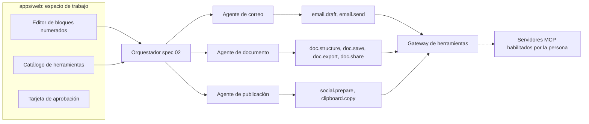
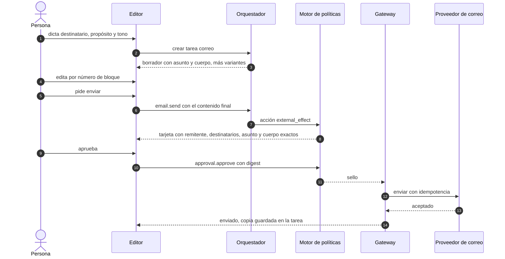

# Diseño: 04 Espacio de trabajo

**Estado:** completo. Requisitos: `requirements.md` (REQ-04-001 a REQ-04-064).

## 1. Principios

1. **Se edita por número, no por puntería.** Los bloques se numeran y se seleccionan por voz o con cualquier modalidad.
2. **El agente propone; la persona decide.** Toda salida es una propuesta hasta que se aprueba.
3. **Guardar es interno; salir al mundo es externo.** Guardar y exportar localmente son `internal_write`; enviar, compartir y publicar son `external_effect`.
4. **Las herramientas crecen con la necesidad,** sin saltarse el gateway.

## 2. Arquitectura



## 3. Herramientas de las tres tareas

| Herramienta | Clase de efecto | Reversible | Notas |
| --- | --- | --- | --- |
| `llm.complete` | `read` | n/a | Con consentimiento por proveedor y minimización (spec 02) |
| `email.draft` | `internal_write` | sí (borrar borrador) | Crea el borrador en la plataforma |
| `email.send` | **`external_effect`** | no | Exige sello; muestra remitente, destinatarios, asunto y cuerpo exactos |
| `doc.structure` | `read` | n/a | Ordena las notas dictadas en secciones |
| `doc.save` | `internal_write` | sí | Guarda en Markdown |
| `doc.export` | `internal_write` | sí | DOCX y PDF `[SUPUESTO, PA-16]` |
| `doc.share` | **`external_effect`** | no | Enlace, correo o servicio conectado |
| `social.prepare` | `internal_write` | sí | Texto, variantes, límites por red y texto alternativo |
| `clipboard.copy` | `internal_write` (local) | sí | Solo en el dispositivo de la persona |

`email.send` se implementa **de forma nativa** en el gateway con la autorización (OAuth) de la cuenta de la persona; n8n es opcional (D-02-8). Las credenciales se guardan cifradas y solo las lee el gateway (REQ-04-022).

## 4. Editor de bloques numerados

- Un documento es una lista de **bloques** (`id`, `kind`, `text`, `order`). La interfaz muestra el número de orden al lado de cada bloque.
- Instrucciones de edición dictadas se interpretan como `{verbo, bloque, parámetros}`: «más corto el 3», «más formal el 2», «borra el 4», «agrega después del 2» (REQ-04-002, 003).
- **Antes y después:** cada edición muestra el bloque anterior y el nuevo; Deshacer vuelve a la versión previa (REQ-04-004).
- **Versiones:** cada cambio aceptado crea una versión (`version_id`, `parent_id`, `blocks`, `author`).
- **Lectura en voz alta:** el editor usa el servicio de voz local de la spec 01; pausa y reanuda por bloque (REQ-04-005).
- **Sin puntería:** nada requiere seleccionar texto con el puntero, arrastrar ni doble clic (REQ-04-006).

## 5. Flujos de las tres tareas

### 5.1 Correo o mensaje profesional



### 5.2 Notas dictadas → documento

1. La persona dicta en modo dictado (spec 01); el texto queda como borrador de bloques crudos.
2. `doc.structure` propone título, secciones y resumen sin añadir hechos; marca los fragmentos reformulados de forma importante (REQ-04-030, 031).
3. La persona edita por número; `doc.save` y `doc.export` son acciones internas (REQ-04-033).
4. Compartir fuera de la plataforma pasa por `doc.share` con aprobación (REQ-04-034).

### 5.3 Publicación para redes lista para publicar

1. La persona dicta tema, red y tono.
2. `social.prepare` produce texto y variantes, aplica los límites de la red desde una configuración y sugiere texto alternativo para las imágenes (REQ-04-041, 042).
3. El sistema avisa si el texto parece contener datos personales de terceros (REQ-04-045).
4. Estado final **lista para publicar**: texto, variantes y texto alternativo guardados; copiar al portapapeles con una orden (REQ-04-043, 044). **No se publica** en el MVP.

## 6. Catálogo de herramientas conectadas

Pantalla que lista las herramientas habilitadas y las disponibles del catálogo curado. Cada ficha muestra: qué hace, qué datos recibe y si puede cambiar algo fuera de la plataforma. Habilitar o deshabilitar exige una aprobación (REQ-04-051) y sigue la secuencia 5.2 de la spec 02. El estado de cada herramienta (conectada, desconectada, con error) se muestra con texto y permite reconectar (REQ-04-052).

## 7. Modelo de datos mínimo

```
deliverable(id, person_id, task_id, kind, state)            -- state: draft | ready | sent | shared
version(id, deliverable_id, parent_id, blocks jsonb_enc, author, created_at)   -- cifrado con la clave de la persona
connection(id, person_id, provider, credential_enc, status)
tool_enablement(person_id, tool_name, enabled_at)            -- spec 02
```

## 8. Decisiones y alternativas descartadas

| # | Decisión | Descartado | Por qué |
| --- | --- | --- | --- |
| D-04-1 | Edición por número de bloque. | Selección de texto con el puntero; edición libre solo por teclado. | V-05. |
| D-04-2 | `email.send` nativo con OAuth. | Solo n8n. | Menos dependencia de una licencia dudosa (PA-09) y menos piezas. |
| D-04-3 | Publicación en redes: solo «lista para publicar». | Publicar con un servicio conectado. | El MVP pidió dejarla lista; publicar sumaría un efecto externo y una conexión (PA-17). |
| D-04-4 | Markdown como formato interno. | DOCX como formato interno. | Versionado y comparación simples (PA-16). |
| D-04-5 | Tarjeta con el contenido exacto, no un resumen. | Resumen del modelo. | D-02-4. |
| D-04-6 | Documentos y borradores cifrados con la clave de la persona. | Solo cifrado de disco. | V-11. |

## 9. Modelo de amenazas y qué ve cada parte

| Amenaza | Mitigación |
| --- | --- |
| Un correo recibido o un documento con instrucciones ocultas que manipulan al agente | Datos no confiables; el envío sigue exigiendo sello y mostrando el contenido exacto |
| Destinatario añadido sin que la persona lo note | Destacar destinatarios nuevos y leerlos en voz alta (REQ-04-024) |
| Robo de la credencial del correo | Cifrada, solo gateway, revocable |
| Datos de terceros en publicaciones | Aviso previo (REQ-04-045) |
| Contenido enviado al modelo sin consentimiento | Consulta de consentimiento antes del envío (REQ-04-062) |

| Parte | Ve |
| --- | --- |
| Persona | Todo lo suyo |
| Cuidador/a | Solo con `content.view` |
| Operador | Nada del contenido |
| Proveedor del modelo | El texto mínimo de cada paso, con consentimiento |
| Proveedor de correo | Lo que la persona aprobó enviar, exactamente |

## 10. Propiedades de corrección

| ID | Propiedad | REQ |
| --- | --- | --- |
| P-04-1 | Ningún correo ni documento compartido sale sin sello sobre su contenido exacto. | 023, 025, 034 |
| P-04-2 | Guardar y exportar localmente no pide aprobación y no sale del dispositivo ni de la plataforma. | 033 |
| P-04-3 | La publicación nunca se envía a una red en el MVP. | 043 |
| P-04-4 | Toda edición de un bloque conserva la versión anterior. | 004 |
| P-04-5 | Ninguna interacción del editor requiere arrastre, doble clic ni selección con puntero. | 006 |
