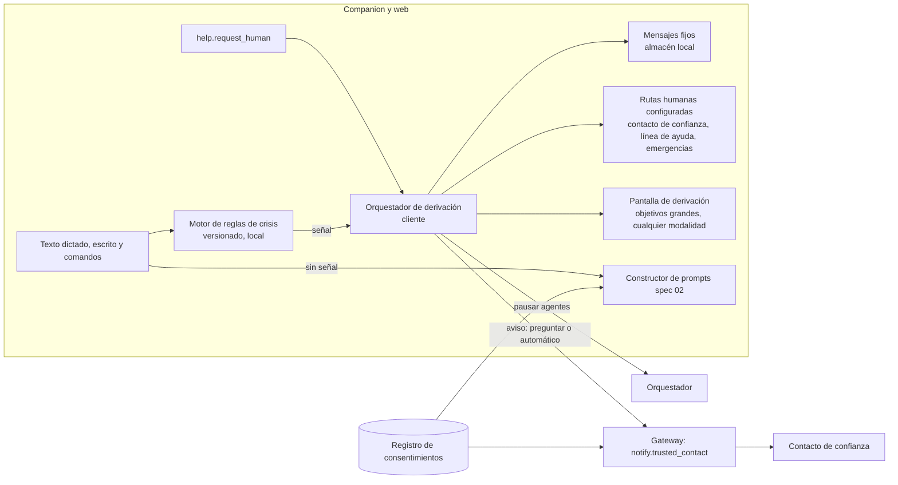
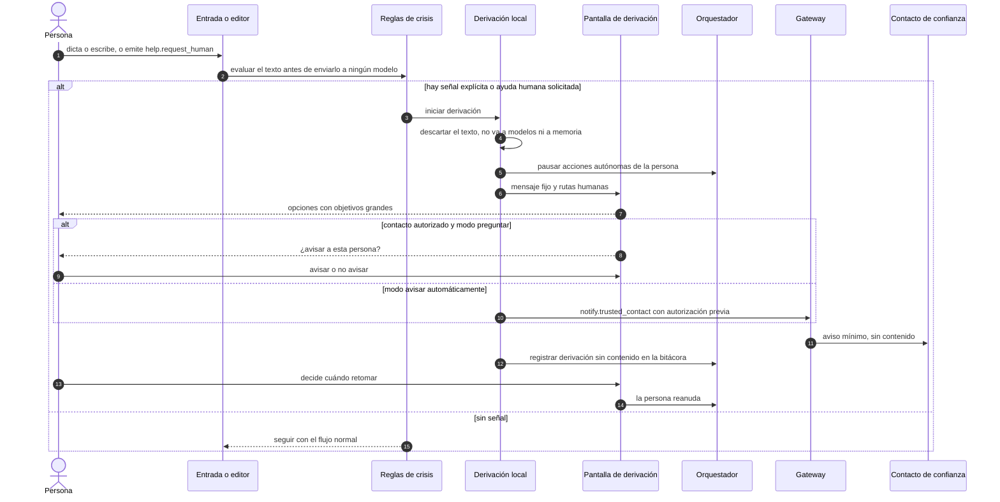

# Diseño: 05 Seguridad y bienestar

**Estado:** completo. Requisitos: `requirements.md` (REQ-05-001 a REQ-05-054). Producto: `.kiro/steering/safety.md`.

## 1. Principios

1. **La IA no maneja la crisis: la entrega a una persona.**
2. **Determinista y local.** Las reglas, los mensajes y las rutas viven en el dispositivo; no dependen de la red ni de un modelo.
3. **Preferir el falso positivo.**
4. **Lo que se detecta no se comparte.** El texto de una señal de crisis no va a ningún proveedor ni a la memoria.
5. **Consentimiento explícito, granular y revocable,** verificado antes de cada envío de datos.

## 2. Arquitectura



**Una sola fuente de reglas.** Las reglas y los mensajes viven en `packages/safety/` (archivos versionados) y los cargan Python (companion y orquestador) y TypeScript (web). Una prueba de paridad ejecuta el mismo corpus en ambos (REQ-05-016). [SUPUESTO: `packages/safety` es un paquete nuevo del monorepo; `structure.md` lo incorpora.]

## 3. Secuencia: señal de crisis → derivación



El mensaje fijo y la pantalla de derivación se muestran **aunque no haya red**. El aviso al contacto, si no hay red, queda en cola y se envía al volver, solo si la persona lo pidió o lo había autorizado de forma automática (REQ-05-006, 010).

## 4. Reglas de crisis

- **Formato:** archivos versionados (`rules/crisis.es-EC.yaml`) con patrones y frases explícitas, normalización de acentos y de variantes de escritura, y un `reviewed_by`/`reviewed_at` obligatorio. La revisión la hace un profesional de salud mental antes de ofrecer el sistema a personas reales (SF-06).
- **Alcance:** solo señales explícitas de crisis. No hay puntuación de ánimo, ni inferencia a partir de uso, voz o imagen (REQ-05-015).
- **Prueba:** un corpus sintético de frases explícitas marcadas debe activar la derivación al 100% (REQ-05-017). Los falsos positivos se miden y se reducen sin sacrificar la sensibilidad.
- **Cambios:** una modificación sin nota de revisión rompe la CI (REQ-05-016).

## 5. Rutas humanas y notificación

```
route_config(person_id, kind, label, address_enc, mode)     -- kind: trusted_contact | official_helpline | emergency
-- official_helpline y emergency: datos de configuración del operador, sin valores en el código
-- trusted_contact: la persona lo da de alta y lo autoriza (REQ-05-014)
```

- **Modo preguntar (por defecto):** antes de avisar, la pantalla muestra «avisar» y «no avisar» con el mismo tamaño y sin opción preseleccionada.
- **Modo automático:** solo si la persona lo eligió antes, de forma explícita, con una prueba de envío aprobada. Es una autorización previa, revocable y visible (C-07).
- **Contenido del aviso:** una plantilla fija: que la persona pidió ayuda y que se comunique con ella. Sin contenido de tareas (REQ-05-011).
- **Política:** la herramienta `notify.trusted_contact` es `external_effect`. En modo preguntar sigue el flujo de aprobación normal. En modo automático, la política acepta un **sello de autorización previa** atado a esa herramienta y a ese contacto, emitido cuando la persona eligió el modo y revocable en cualquier momento.

## 6. Límites de la IA

- **Peticiones de consejo (REQ-05-020):** antes de pasar al agente, un clasificador por reglas y, si hace falta, un modelo con consentimiento detecta peticiones de consejo médico, psicológico, legal o financiero. Si coincide, responde con el mensaje fijo de límites y ofrece una ruta humana, sin pasar la petición al agente.
- **Filtro de salida (REQ-05-021):** las propuestas y textos generados pasan por una lista de expresiones prohibidas (afirmaciones clínicas, promesas de efecto, suplantación). Lo que coincide se reemplaza o se marca antes de mostrarse.
- **Lenguaje de la interfaz (REQ-05-024):** la CI rechaza palabras prohibidas en el catálogo de textos.

## 7. Consentimientos

```
consent_record(id, person_id, category, provider, text_version, decision, modality, at)
consent_current(person_id, category, provider, decision, text_version)     -- vista
```

- **Categorías (REQ-05-030):** `llm_content[provider]`, `cloud_stt`, `cloud_tts`, `trusted_contact_notify[mode]`, `declared_condition`, `aggregate_metrics`, `diagnostic_recording`, `profile_sync` (post-MVP).
- **Consulta única de consentimiento:** `consent.check(person, category, provider)` la usan el gateway, el constructor de prompts y el reconocimiento en la nube. Sin consentimiento vigente, no se envía (REQ-05-036).
- **Por defecto, todo apagado** (REQ-05-031). La persona usa el sistema sin los opcionales, con las funciones afectadas explicadas (REQ-05-033).
- **Texto:** resumen en lenguaje llano, lectura en voz alta y texto completo (REQ-05-032). Un cambio importante invalida la decisión previa hasta una nueva (REQ-05-037).
- **Sin vencimiento por tiempo, sin insistencia** tras un rechazo (REQ-05-038).
- **Cuidador/a:** puede ayudar, pero la decisión la confirma la persona con su modalidad, salvo una delegación explícita (REQ-05-039).

## 8. Decisiones y alternativas descartadas

| # | Decisión | Descartado | Por qué |
| --- | --- | --- | --- |
| D-05-1 | Reglas explícitas, versionadas y locales. | Clasificador de modelo de lenguaje; clasificador de ML entrenado. | Auditable, determinista, sin enviar texto sensible a terceros (SF-01, V-09). |
| D-05-2 | Mensajes fijos revisados por un profesional. | Mensaje generado. | SP-7. |
| D-05-3 | Pausar agentes durante la derivación. | Seguir ejecutando. | Evita acciones mientras la persona está en crisis `[SUPUESTO]`. |
| D-05-4 | Modo preguntar por defecto para avisar al contacto. | Aviso automático por defecto. | V-01 y C-07. |
| D-05-5 | Rutas humanas como configuración. | Números escritos en el código. | PA-04 omitida (C-06); el operador define los valores cuando corresponda. |
| D-05-6 | Verificar consentimiento en el gateway y en el constructor de prompts. | Verificar solo en la interfaz. | Defensa en profundidad. |
| D-05-7 | Paquete compartido `packages/safety` para Python y TypeScript. | Reglas duplicadas. | Una sola fuente. |

## 9. Modelo de amenazas y qué ve cada parte

| # | Amenaza | Mitigación |
| --- | --- | --- |
| C-01 | El texto de una crisis llega a un proveedor del modelo | Reglas antes del constructor de prompts; descartar el texto (REQ-05-001, 002) |
| C-02 | Falso negativo | Corpus, umbral permisivo, `help.request_human` siempre disponible (REQ-05-003, 017) |
| C-03 | Un tercero dispara avisos falsos al contacto | Solo la persona o sus reglas locales disparan; el aviso lleva una plantilla mínima |
| C-04 | Abuso del contacto de confianza | Alta, prueba y revocación por la persona (REQ-05-014) |
| C-05 | Consentimiento forzado o por defecto | Todo apagado, sin insistencia, separado por categoría (REQ-05-031, 038) |
| C-06 | Un agente genera mensaje clínico | Filtro de salida y lista prohibida (REQ-05-021, 024) |

| Parte | Ve |
| --- | --- |
| Persona | Todo lo suyo, incluido el registro de derivaciones |
| Cuidador/a | Nada de crisis, salvo que sea el contacto de confianza que la persona autorizó (REQ-06-036) |
| Operador | Nada de eventos de crisis ni de consentimientos individuales |
| Proveedor del modelo | Nunca el texto de una señal de crisis |
| Contacto de confianza | Solo el aviso mínimo |
| Hosting | Eventos cifrados con la clave de la persona |

## 10. Propiedades de corrección

| ID | Propiedad | REQ |
| --- | --- | --- |
| P-05-1 | Toda señal de crisis del corpus llega a la ruta humana (SP-5). | 003, 017 |
| P-05-2 | El texto de una señal de crisis nunca llega a un proveedor del modelo ni a la memoria (SP-6). | 002 |
| P-05-3 | Los mensajes de crisis son fijos; ningún modelo los genera (SP-7). | 005 |
| P-05-4 | La derivación funciona sin red y sin modelo. | 006, 051 |
| P-05-5 | Sin consentimiento vigente no se envía ningún dato de esa categoría. | 036 |
| P-05-6 | Todos los consentimientos arrancan apagados. | 031 |
| P-05-7 | Un aviso al contacto sin autorización o sin pregunta aprobada nunca se envía. | 010 |
