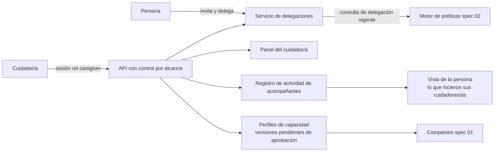
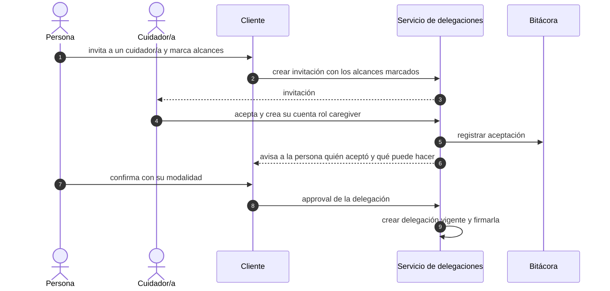
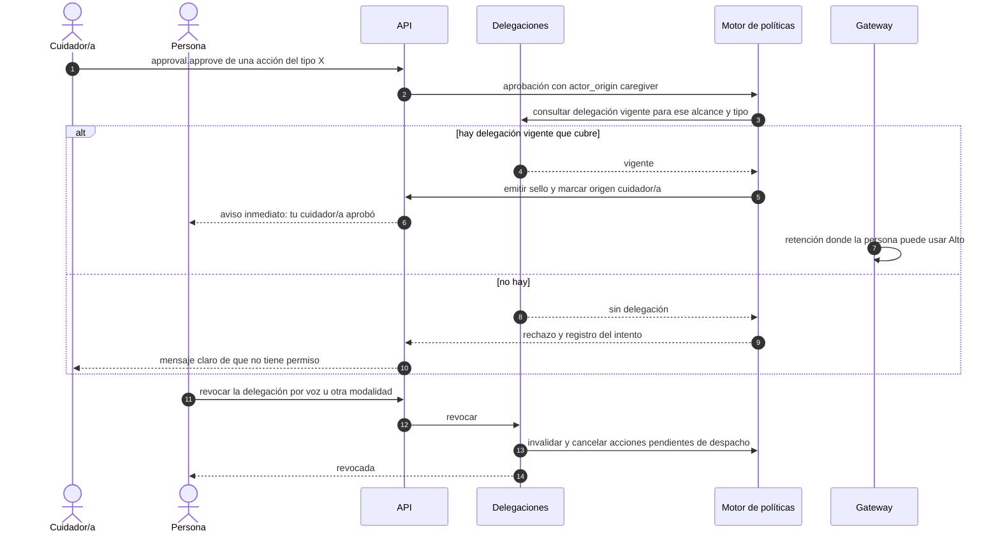

# Diseño: 06 Cuidador y perfiles

**Estado:** completo. Requisitos: `requirements.md` (REQ-06-001 a REQ-06-063).

## 1. Principios

1. **La persona delega; el cuidador/a nunca se auto-otorga permisos.**
2. **Todo permiso es concreto, visible y revocable al instante.**
3. **El filtro de lo que ve el cuidador/a vive en el servidor** (control por alcance en la API), no en la interfaz.
4. **Un cuidador/a no puede ocultar lo que hizo.**

## 2. Arquitectura



## 3. Modelo de datos mínimo

```
caregiver(id, account_id)
invitation(id, person_id, email_enc, scopes[], task_types[], created_at, accepted_at)
delegation(id, person_id, caregiver_id, scopes[], task_types[], starts_at, ends_at null,
           status, signature)
caregiver_activity(id, person_id, caregiver_id, scope, action, ref, at)   -- sin contenido
profile_version(id, profile_id, version, status, proposed_by, approved_at, content_enc)
   -- status: proposed | active | reverted
```

- `delegation.signature`: firma del servicio sobre los campos; una delegación alterada se rechaza (REQ-06-062).
- Estados de delegación: `vigente`, `revocada`, `vencida`. El vencimiento solo ocurre si la persona fijó `ends_at`.

## 4. Secuencias

### 4.1 Invitar y delegar



### 4.2 Aprobación por delegación y revocación inmediata



## 5. Reglas de diseño

- **Control por alcance en la API (REQ-06-031):** cada recurso declara el alcance requerido; sin él, la API responde sin datos. La condición declarada no tiene alcance delegable.
- **Aprobación del cambio de perfil (REQ-06-041):** el cambio del cuidador/a crea una `profile_version` en estado `proposed`; el companion no la usa hasta que la persona la apruebe. Las invariantes de la spec 01 (ruta de Alto y Deshacer) se validan antes de aceptar la propuesta (REQ-06-042).
- **Visibilidad:** la vista «lo que hicieron mis cuidadores/as» lee de `caregiver_activity`, que el cuidador/a no puede modificar (REQ-06-018).
- **Calibración asistida (REQ-06-033):** el cuidador/a conduce el companion con teclado y mouse; las intenciones llevan `actor_origin = caregiver`. Una aprobación así necesita delegación; sin ella, el bus la entrega pero el motor de políticas la rechaza.
- **Invitación del mismo correo de la persona:** se rechaza que una persona se invite a sí misma como cuidador/a para obtener un segundo rol.
- **Revocación:** instantánea y por cualquier modalidad (intención `delegation.revoke` o pantalla); invalida sesiones de acción y despachos pendientes (REQ-06-012).

## 6. Pantallas (comportamiento)

| Pantalla | Quién | Contenido | Estados |
| --- | --- | --- | --- |
| Mis cuidadores/as y permisos | Persona | Lista de delegaciones, revocar, invitar | vacío (sin cuidadores: ofrecer invitar sin presionar), error, sin conexión |
| Lo que hicieron mis cuidadores/as | Persona | Actividad con alcance, acción y fecha | vacío, cargando |
| Panel del cuidador/a | Cuidador/a | Dispositivos, calibración asistida, perfiles, contadores | cargando, vacío, error, sin conexión, modalidad no detectada |
| Versión de perfil pendiente | Persona | Qué cambió, aprobar o revertir | error |

## 7. Decisiones y alternativas descartadas

| # | Decisión | Descartado | Por qué |
| --- | --- | --- | --- |
| D-06-1 | La persona crea y cambia las delegaciones; el cuidador/a solo puede pedirlas. | Cuidador/a que se autoasigna. | V-12. |
| D-06-2 | Alcances concretos en lugar de roles amplios. | Rol «cuidador/a total». | Mínimo privilegio; la persona entiende cada permiso. |
| D-06-3 | Control por alcance en la API. | Ocultar en la interfaz. | Una interfaz puede evadirse. |
| D-06-4 | Cambios de perfil como versión pendiente que la persona aprueba. | Aplicar al instante. | La persona sigue controlando su acceso. |
| D-06-5 | Contadores por defecto, contenido solo con `content.view`. | Cuidador/a ve todo. | V-11 y V-09. |
| D-06-6 | Fecha de fin opcional elegida por la persona. | Delegaciones que vencen solas por defecto. | AX-03: el sistema no impone plazos a la persona. |

## 8. Modelo de amenazas y qué ve cada parte

| # | Amenaza | Mitigación |
| --- | --- | --- |
| D-01 | Cuidador/a aprueba sin permiso | Verificación de delegación (REQ-06-015) |
| D-02 | Cuidador/a amplía sus propios permisos | Solo la persona crea o cambia delegaciones (REQ-06-011) |
| D-03 | Delegación alterada en la base | Firma (REQ-06-062) |
| D-04 | Cuidador/a oculta su actividad | Registro que no puede modificar (REQ-06-018) |
| D-05 | Cuidador/a cambia el perfil para quitar el Alto | Invariantes al proponer (REQ-06-042) |
| D-06 | Cuidador/a exporta o borra datos | No tiene ese alcance (REQ-06-035) |

| Parte | Ve |
| --- | --- |
| Persona | Todas sus delegaciones y la actividad de sus cuidadores/as |
| Cuidador/a | Solo lo que cubren sus alcances |
| Operador | Cuentas y roles como identificadores; sin contenido |
| Proveedor del modelo | Nada de las delegaciones |

## 9. Propiedades de corrección

| ID | Propiedad | REQ |
| --- | --- | --- |
| P-06-1 | Sin delegación vigente, una aprobación de cuidador/a nunca produce un sello (SP-4). | 015 |
| P-06-2 | Un cuidador/a nunca crea ni amplía sus propias delegaciones. | 006, 011 |
| P-06-3 | Revocar invalida de inmediato las acciones pendientes del cuidador/a. | 012 |
| P-06-4 | La condición declarada nunca es visible para un cuidador/a. | 031 |
| P-06-5 | Un perfil propuesto por un cuidador/a sin Alto y Deshacer se rechaza. | 042 |
