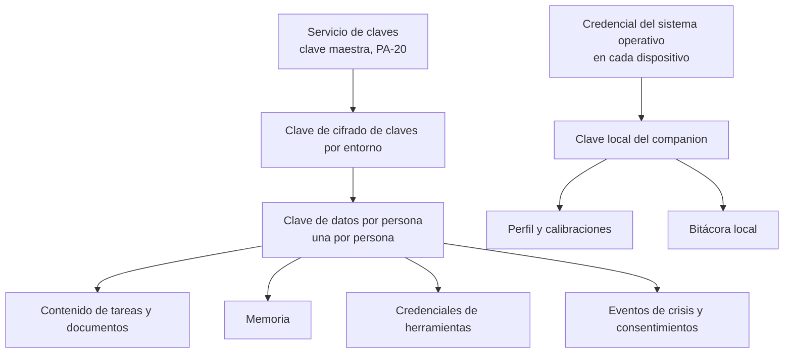
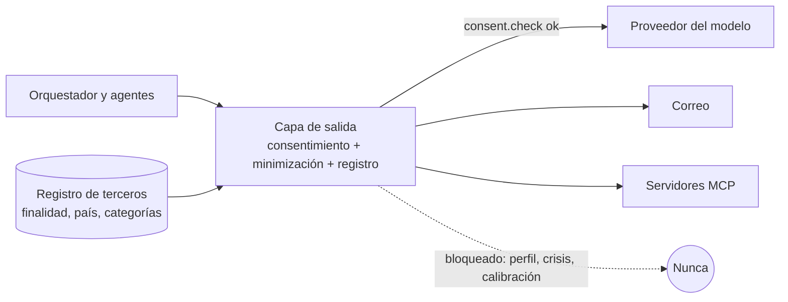
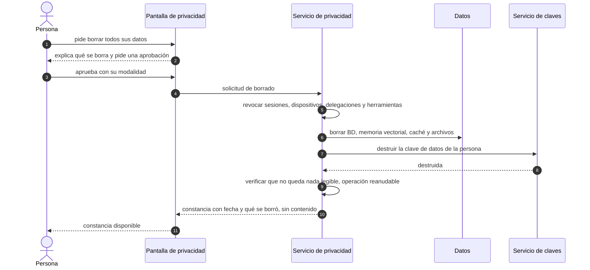

# Diseño: 07 Privacidad y datos

**Estado:** completo. Requisitos: `requirements.md` (REQ-07-001 a REQ-07-073). Lo marcado `[verificar con abogado]` es una hipótesis legal sin confirmar; este documento no es asesoría legal.

## 1. Principios

1. **Minimizar:** lo que no se guarda no se puede filtrar (audio, video, landmarks, prompts y respuestas: retención cero).
2. **Una clave por persona:** el contenido se cifra con una clave de datos propia; destruirla borra el contenido, incluso en copias de seguridad.
3. **El operador no tiene vía de lectura** (V-11).
4. **Los derechos se ejercen con cualquier modalidad y sin plazos para la persona.**

## 2. Inventario de datos (extracto; el archivo vivo es `docs/data-inventory.yaml`)

| Dato | Categoría especial | Dónde | Quién lo ve | Retención |
| --- | --- | --- | --- | --- |
| Cuadros de video, audio, landmarks | Sí (biométrico) | Solo memoria del dispositivo | Nadie fuera del proceso | Cero |
| Perfil de capacidad | Sí | Dispositivo, cifrado | Persona; cuidador/a con `profile.edit` | Hasta que la persona borre |
| Calibraciones (umbrales) | Sí | Dispositivo | Persona | Hasta que la persona borre |
| Condición declarada (opcional) | Sí | Cuenta, cifrada | Solo la persona | Hasta que la persona borre |
| Contenido de tareas, propuestas, documentos | Sí | Servidor, cifrado con clave de la persona | Persona; cuidador/a con `content.view` | Hasta que la persona borre |
| Memoria del orquestador | Sí | pgvector, cifrada | Persona | Hasta que la persona borre |
| Credenciales de herramientas y correo | No (secreto) | Servidor, cifradas | Solo el gateway | Hasta revocar |
| Bitácora | Parcial (metadatos de uso) | Servidor y dispositivo | Persona; cuidador/a según delegación | Política de retención |
| Consentimientos | Sí | Servidor | Persona | Hasta que la persona borre |
| Eventos de crisis (metadatos) | Sí | Servidor, cifrados | Persona | Política de retención |
| Delegaciones y actividad de cuidadores/as | Sí | Servidor | Persona; cuidador/a la suya | Política de retención |
| Cuenta (correo, idioma) | No | Servidor | Persona | Hasta borrar la cuenta |
| Métricas operativas sin contenido | No | Servidor | Operador | Retención limitada |
| Contadores agregados anónimos | No | Servidor | Operador | Retención limitada |
| Prompts y respuestas de modelos | Sí | No se guardan | n/a | Cero |

## 3. Jerarquía de claves

- **Borrado criptográfico:** destruir la DEK de la persona vuelve ilegible su contenido en la base, en la memoria vectorial y en las copias de seguridad (REQ-07-033, 035).
- **Rotación:** la KEK y las DEK se rotan reencriptando bajo demanda (REQ-07-015).
- **Uso anómalo:** todo uso de claves fuera del flujo normal se registra y alerta (REQ-07-014).

## 4. Aislamiento por persona

- **Seguridad por filas** en PostgreSQL por `person_id` (REQ-02-072). Los roles de aplicación no pueden desactivarla.
- **Roles de base de datos:** `app_rw` (servicio de persistencia), `app_ro_audit` (bitácora, solo lectura de metadatos), `admin` (migraciones, sin uso rutinario, con alerta de cada conexión). Ningún rol del operador lee contenido (REQ-07-055).
- **Sin acceso de emergencia al contenido** (REQ-07-057).

## 5. Capa de salida a terceros

- La capa de salida es la única con egreso (junto con el gateway de la spec 02, que la usa).
- Bloquea por esquema los campos prohibidos: perfil de capacidad, condición declarada, eventos de crisis, calibraciones, cuadros y audio (REQ-07-021, 022).
- Mantiene el **registro de terceros** con finalidad, país y categorías (REQ-07-023, 024). Los que reciben datos fuera de Ecuador se marcan para revisión `[verificar con abogado]`.
- Exige a los proveedores de modelos configuraciones sin retención ni entrenamiento cuando existan, y se verifica por contrato `[verificar]` (REQ-07-025).

## 6. Derechos de la persona

- **Acceso:** pantalla en lenguaje llano con los datos, la finalidad y los terceros (REQ-07-030).
- **Exportación:** archivo con JSON y los entregables en su formato; se genera en segundo plano y se avisa al terminar (REQ-07-031, 070).
- **Rectificación:** se actualiza en todas las copias vivas (REQ-07-032).
- **Oposición o suspensión:** se materializa como revocación del consentimiento de esa finalidad (REQ-07-036) `[verificar con abogado los derechos exactos]`.
- **Borrado reanudable:** cada paso deja registro para poder repetirlo si algo falla (REQ-07-073).
- **Cuidador/a:** no ejerce estos derechos sin delegación específica (REQ-07-038).

## 7. Retención [SUPUESTO en los valores]

| Categoría | Regla |
| --- | --- |
| Audio, video, landmarks, prompts y respuestas | Cero (no se guardan) |
| Contenido de tareas y entregables | Hasta que la persona lo borre (REQ-07-047) |
| Bitácora y registros técnicos | Plazo limitado a definir con el abogado |
| Copias de seguridad | Cifradas, con retención definida; el borrado criptográfico las invalida |
| Métricas | Retención limitada |

## 8. Decisiones y alternativas descartadas

| # | Decisión | Descartado | Por qué |
| --- | --- | --- | --- |
| D-07-1 | Clave de datos por persona y borrado criptográfico. | Cifrado solo a nivel de disco; borrado fila por fila en copias. | Garantiza el borrado en copias y aísla personas. |
| D-07-2 | Retención cero de prompts, respuestas, audio y landmarks. | Guardar para depuración. | Minimización y V-06. |
| D-07-3 | Sin acceso de emergencia del operador al contenido. | Break-glass para soporte. | V-11; si hace falta soporte, la persona exporta y comparte. |
| D-07-4 | Capa de salida única con lista de campos prohibidos. | Controles dispersos. | Un solo punto auditable (SP-6). |
| D-07-5 | Perfil de capacidad solo local en el MVP. | Sincronización cifrada de extremo a extremo. | Menos datos de categoría especial en el servidor (S-11). |
| D-07-6 | Inventario de datos en el repositorio con auditoría en la CI. | Hoja de cálculo externa. | Se mantiene al día con el código (REQ-07-002). |

## 9. Modelo de amenazas

| # | Amenaza | Mitigación |
| --- | --- | --- |
| E-01 | Volcado de la base de datos | Cifrado a nivel de aplicación con DEK por persona |
| E-02 | Operador o administrador curiosea | Sin vías de lectura, roles sin acceso a contenido, alertas de uso de claves |
| E-03 | Proveedor del modelo retiene datos | Configuración sin retención, contrato, minimización, consentimiento |
| E-04 | Datos residuales tras el borrado | Borrado criptográfico y verificación |
| E-05 | Un agente exfiltra datos | Sin red ni credenciales; capa de salida |
| E-06 | Incidente de seguridad | Procedimiento, identificación de afectados vía bitácora e inventario (REQ-07-065, 066) |

## 10. Qué ve cada parte (matriz completa del sistema)

| Dato | Persona | Cuidador/a | Operador | Proveedor del modelo | Proveedor de nube (hosting) | Contacto de confianza | Empresa (fase 2) |
| --- | --- | --- | --- | --- | --- | --- | --- |
| Video, audio, landmarks | No salen del dispositivo | No | No | No | No | No | No |
| Perfil de capacidad | Sí | Con `profile.edit` | No | **Nunca** | Si hay sincronización: cifrado | No | **Nunca** |
| Condición declarada | Sí | **Nunca** | No | **Nunca** | Cifrada | No | **Nunca** |
| Contenido de tareas | Sí | Con `content.view` | **No** | Mínimo por paso, con consentimiento | Cifrado | No | Solo el entregable aprobado |
| Bitácora | Sí | Según delegación | Solo metadatos técnicos | No | Cifrada | No | No |
| Eventos de crisis | Sí | **No** | **No** | **Nunca** | Cifrados | Solo el aviso mínimo | No |
| Consentimientos | Sí | Según delegación de ayuda | No | No | Cifrados | No | No |
| Métricas agregadas | Sí | Contadores con `progress.view` | Anónimas, con consentimiento | No | n/a | No | No |

Riesgo residual (C-09): el proceso del orquestador ve el contenido de forma transitoria para llamar al modelo. Quien controle el proceso y las claves podría leerlo. Mitigaciones: separación de funciones sobre las claves, alertas de acceso y auditoría. No se puede eliminar sin impedir que el modelo trabaje con el contenido.

## 11. Propiedades de corrección

| ID | Propiedad | REQ |
| --- | --- | --- |
| P-07-1 | Ningún campo prohibido sale por la capa de salida (SP-3, SP-6). | 020 a 022 |
| P-07-2 | Tras un borrado, el contenido de la persona es ilegible en la base y en las copias. | 033, 035 |
| P-07-3 | Ningún rol del operador puede leer contenido. | 055 |
| P-07-4 | Todo campo nuevo aparece en el inventario de datos. | 002 |
| P-07-5 | La retención de audio, video, landmarks y prompts es cero. | 046 |
| P-07-6 | El borrado interrumpido se puede reanudar sin dejar datos legibles. | 073 |
