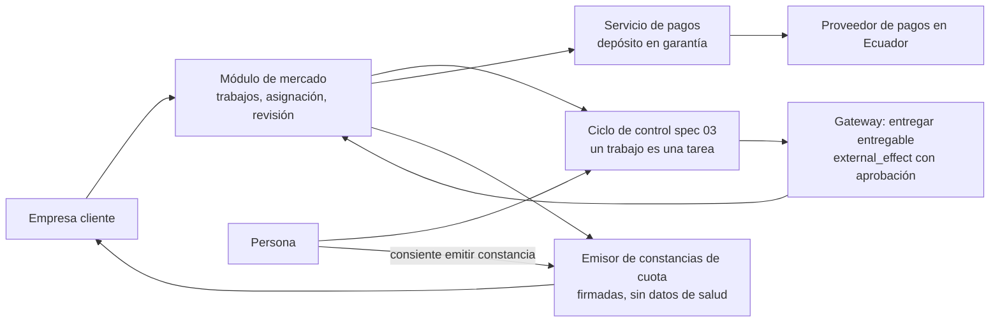
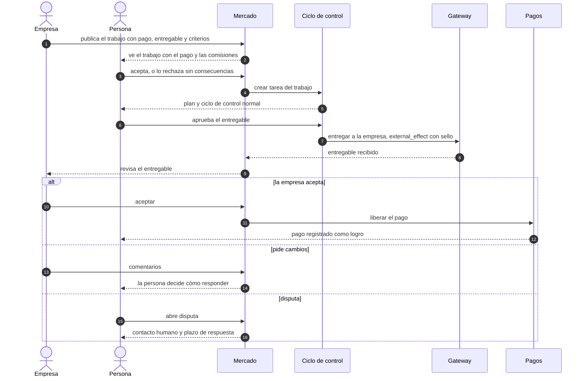
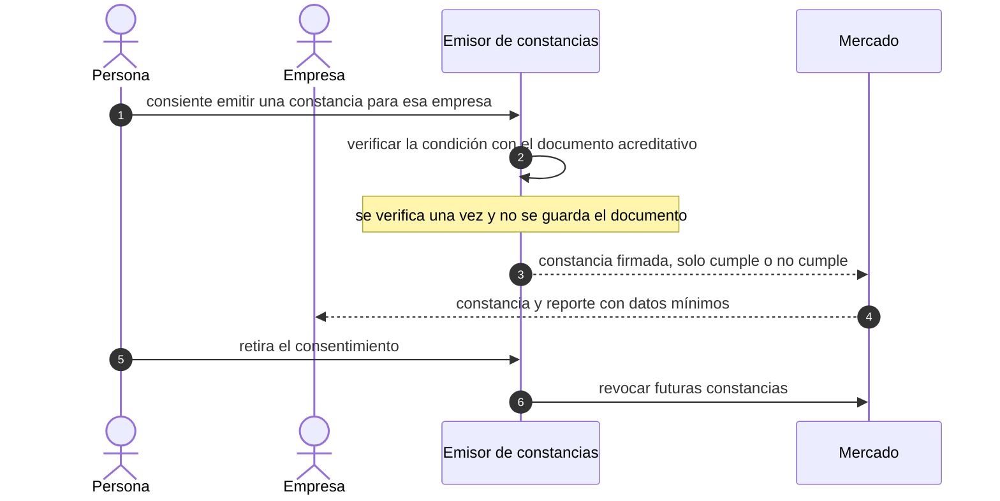

# Diseño: 08 Mercado B2B (fase 2)

**Estado:** completo. **Fase 2: solo diseño; sin tareas del MVP.** Requisitos: `requirements.md` (REQ-08-001 a REQ-08-062). Lo marcado `[verificar con abogado]` es una hipótesis legal sin confirmar.

## 1. Principios

1. **Paga la empresa, no la persona** (patrón de Inclusively, Be My Eyes y Specialisterne en la investigación base).
2. **Un trabajo es una tarea del ciclo de control:** la persona lo elige, los agentes ejecutan, la persona aprueba y el resultado sale al mundo (V-01, V-02).
3. **La empresa ve el entregable, nunca a la persona:** ni su perfil de capacidad, ni su condición, ni sus consentimientos.
4. **Pago transparente y sin trampas de piezas:** la investigación señala el riesgo de pagar por pieza en trabajos de bajo valor.
5. **La cuota del 4% se acredita con la mínima información.**

## 2. Arquitectura



El módulo de mercado es parte del monolito del orquestador y de `apps/web` (carpetas `features/market`) [SUPUESTO]; no es un servicio nuevo hasta que haga falta.

## 3. Modelo de datos mínimo

```
company(id, legal_name, tax_id, verified_at)
job(id, company_id, title, description, expected_deliverable, pay_model, pay_amount, criteria, state)
   -- pay_model: hourly | per_deliverable ; state: open | accepted | in_review | completed | disputed
assignment(id, job_id, person_id, task_id, accepted_at)
deliverable_review(id, assignment_id, decision, comments_enc, at)
payment(id, assignment_id, amount, state)     -- pending | held | paid | disputed
quota_attestation(id, person_id, company_id, issued_at, signature, revoked_at)
   -- contiene solo: que la persona cumple el criterio de cuota, fecha y firma. Sin tipo ni grado.
```

## 4. Flujos

### 4.1 Del trabajo al pago



### 4.2 Constancia de cuota del 4%



## 5. Reglas de diseño

- **Muro de privacidad:** el rol `company` tiene un conjunto de recursos cerrado (trabajos propios, entregables aceptados, constancias). No tiene acceso a tablas de perfiles, consentimientos, delegaciones ni eventos de crisis (REQ-08-002, 003).
- **Entregar es una acción externa:** el entregable sale solo con sello de aprobación y la tarjeta muestra exactamente qué ve la empresa (REQ-08-022).
- **Pago transparente:** el trabajo declara si es por hora o por entregable y las comisiones; la persona lo ve antes de aceptar (REQ-08-011). Retiros de dinero requieren aprobación de la persona (REQ-08-044).
- **Plazos:** el plazo de referencia es ajustable por acuerdo; las pausas no se penalizan (REQ-08-012).
- **Constancia:** documento firmado con la mínima información; la verificación del documento acreditativo ocurre una vez y no se conserva (REQ-08-030) `[verificar con abogado qué acredita la condición]`.
- **Pagos:** se delega todo manejo de tarjetas y cuentas a un proveedor que opere en Ecuador (REQ-08-041) `[verificar proveedor]`. La facturación sigue la normativa tributaria `[verificar con contador]`.
- **Sin garantía legal:** los textos no prometen cumplimiento legal de la cuota (REQ-08-033).

## 6. Decisiones y alternativas descartadas

| # | Decisión | Descartado | Por qué |
| --- | --- | --- | --- |
| D-08-1 | Un trabajo es una tarea del ciclo de control. | Un flujo aparte para trabajo remunerado. | Reutiliza aprobación, bitácora y logros; mantiene V-01 y V-02. |
| D-08-2 | Constancia firmada con «cumple / no cumple». | Compartir el carné o el grado de discapacidad. | Minimización de categoría especial (V-09). |
| D-08-3 | Depósito en garantía mediante un proveedor de pagos. | Pagar directo empresa → persona. | Protege a ambas partes y habilita disputas. |
| D-08-4 | Preferir pago por hora o por entregable de tamaño acordado. | Pago por pieza mínima. | La investigación advierte del riesgo de tareas de bajo valor y de entrenar a quien las reemplaza. |
| D-08-5 | Módulo dentro del monolito. | Servicio separado desde el inicio. | Menos complejidad en la fase 2 inicial. |

## 7. Modelo de amenazas y qué ve cada parte

| # | Amenaza | Mitigación |
| --- | --- | --- |
| F-01 | La empresa obtiene datos de salud o discapacidad | Rol sin acceso; constancia mínima (REQ-08-003, 030) |
| F-02 | Presión para aceptar trabajos o plazos | Rechazar sin consecuencias; plazos ajustables (REQ-08-012, 021) |
| F-03 | Fraude de empresas | Verificación legal (REQ-08-001) |
| F-04 | Retención indebida de pagos | Disputas con plazo y contacto humano (REQ-08-050) |
| F-05 | Operador lee entregables | Sin acceso salvo que la persona los comparta en una disputa (REQ-08-052) |

| Parte | Ve |
| --- | --- |
| Persona | Sus trabajos, pagos, disputas y constancias |
| Cuidador/a | Según delegación |
| Empresa | Trabajos propios, entregables aceptados y constancias consentidas |
| Operador | Métricas agregadas; entregables solo si la persona los comparte en una disputa |
| Proveedor del modelo | El mínimo de cada paso, igual que una tarea |
| Proveedor de pagos | Datos del cobro y del pago, no del contenido |

## 8. Propiedades de corrección

| ID | Propiedad | REQ |
| --- | --- | --- |
| P-08-1 | Ninguna API de empresa devuelve perfil, condición, consentimientos o crisis. | 003 |
| P-08-2 | La entrega a la empresa requiere sello de aprobación sobre el contenido exacto. | 022 |
| P-08-3 | Una constancia no contiene tipo ni grado de discapacidad. | 030 |
| P-08-4 | Ningún retiro de dinero ocurre sin aprobación de la persona. | 044 |
| P-08-5 | Rechazar un trabajo no tiene consecuencias registradas contra la persona. | 021 |
