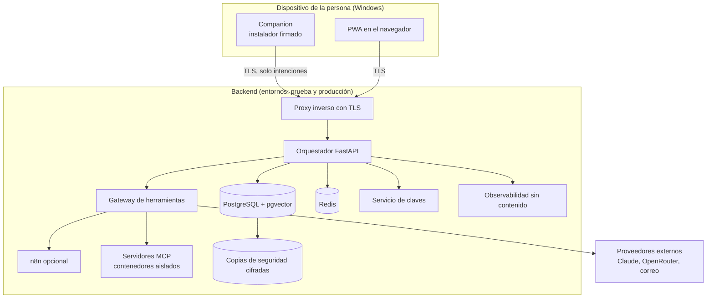
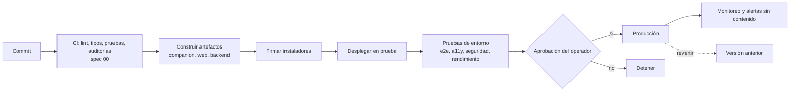
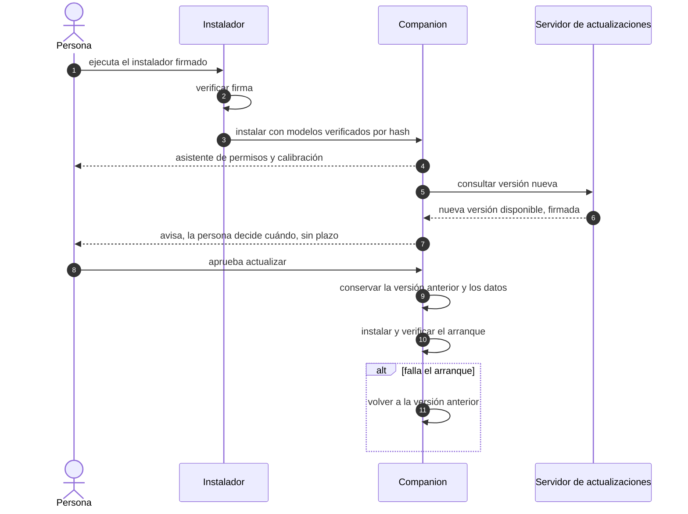

# Diseño: 09 Despliegue

**Estado:** completo. Requisitos: `requirements.md` (REQ-09-001 a REQ-09-063).

## 1. Principios

1. **El companion funciona sin el backend.** Entrada, control del PC, calibración y perfiles no dependen de la red.
2. **Ningún artefacto abre una puerta de salida de datos biométricos** (SP-3): el empaquetado se audita.
3. **Actualizar es decisión de la persona.**
4. **Los entornos no mezclan datos:** prueba solo usa datos sintéticos.

## 2. Topología

## 3. Entornos

| Entorno | Propósito | Datos | Proveedores externos | Notas |
| --- | --- | --- | --- | --- |
| Desarrollo local | Construir y probar | Sintéticos | Simulados | `docker-compose` en `infra/` |
| **Prueba** | Verificar versiones candidatas | Sintéticos | Simulados o cuentas de prueba | Mismas versiones y empaquetado que producción; banner de entorno de prueba en la interfaz (REQ-09-034) |
| **Producción** | Personas reales | Reales | Reales | Promoción manual por el operador; secretos y claves separados |

Reglas: secretos y claves distintos por entorno; sin datos reales fuera de producción (REQ-09-031); proveedores simulados en prueba para que nada contacte a una persona real (REQ-09-033).

## 4. Pipeline de CI/CD

- Mismo commit para companion, web y backend (REQ-09-040).
- Solo se promueven artefactos que pasaron en prueba (REQ-09-041).
- Reversión sin pérdida de datos: migraciones reversibles y versiones anteriores disponibles (REQ-09-021, 042).
- **Indicadores de función:** mirada, switch y mercado B2B están apagados en producción hasta su hito (REQ-09-043).

## 5. Companion en Windows

| Aspecto | Decisión [SUPUESTO] |
| --- | --- |
| Empaquetado | Aplicación congelada (por ejemplo PyInstaller o Nuitka) más un instalador MSIX o Inno Setup; se elige en la primera tarea de empaquetado tras medir tamaño y arranque |
| Firma | Certificado de firma de código; el companion verifica la firma antes de instalar (REQ-09-002) |
| Modelos | MediaPipe y reconocedores incluidos en el instalador o descargados con hash verificado al primer arranque (REQ-09-003) |
| Permisos | Asistente de cámara y micrófono con una explicación breve y pasos operables con voz o ayuda (REQ-09-004) |
| Actualización | La persona aprueba; nunca durante una tarea; se conserva la versión anterior; sin plazo para decidir (REQ-09-005) |
| Datos locales | Perfil, calibraciones y comandos propios se conservan al actualizar y reinstalar (REQ-09-006) |
| Desinstalación | Ofrece borrar o conservar los datos; sin procesos residuales (REQ-09-007) |
| Inicio con Windows | Solo si la persona lo eligió; indicador de cámara y micrófono desde el primer instante (REQ-09-008) |
| Egreso de red | La lista permitida está en el artefacto; el build falla si añade destinos nuevos (REQ-09-009) |

## 6. Web y backend

- **PWA:** política de seguridad de contenido estricta (`connect-src` solo a orígenes propios); modelos de MediaPipe servidos desde el mismo origen (REQ-09-010, 011). Funciona sin conexión para las pantallas ya visitadas (REQ-09-012).
- **Backend en contenedores** definidos en `infra/` (REQ-09-020). Migraciones versionadas y reversibles (REQ-09-021). Credenciales por servicio; los procesos de agentes no reciben las de producción (REQ-09-022).
- **Servidores MCP** en contenedores aislados con red restringida (REQ-09-024).
- **Salud:** comprobaciones por servicio y de dependencias (REQ-09-023).

## 7. Observabilidad y copias de seguridad

- Métricas y registros sin contenido (depurador de la spec 00). Alertas por errores, degradación, ausencia de latido de un companion y servicio de claves caído (REQ-09-050, 052).
- Copias de seguridad cifradas de la base de datos y de archivos, con restauración probada periódicamente (REQ-09-051). El contenido de las copias está cifrado con la clave de la persona (REQ-09-053).
- Objetivos de disponibilidad y de recuperación: valores `[SUPUESTO]` que se fijan tras el primer despliegue (REQ-09-061, 062).

## 8. Decisiones y alternativas descartadas

| # | Decisión | Descartado | Por qué |
| --- | --- | --- | --- |
| D-09-1 | Dos entornos desplegados más el local. | Un solo entorno; un entorno por rama. | Simple y suficiente para el MVP; el de prueba refleja producción. |
| D-09-2 | Contenedores con docker-compose en el MVP. | Orquestación completa (Kubernetes). | Alcance del MVP; se revisa si crece. |
| D-09-3 | Actualizaciones con aprobación de la persona. | Actualización automática. | La persona decide qué corre en su equipo y evita interrupciones. |
| D-09-4 | Modelos con hash verificado. | Descarga sin verificar. | Integridad de la cadena de suministro. |
| D-09-5 | Auditoría del egreso de red en el build. | Confiar en el código. | SP-3. |
| D-09-6 | Hosting y región por decidir (PA-18). | Fijarlos ahora. | Depende de asesoría legal sobre transferencia internacional `[verificar]`. |

## 9. Modelo de amenazas y qué ve cada parte

| # | Amenaza | Mitigación |
| --- | --- | --- |
| G-01 | Instalador o actualización manipulados | Firma y verificación (REQ-09-002) |
| G-02 | Modelo reemplazado por uno malicioso | Hash verificado (REQ-09-003) |
| G-03 | Empaquetado añade destinos de red | Auditoría del build (REQ-09-009) |
| G-04 | Datos reales en el entorno de prueba | Prohibición y auditoría (REQ-09-031) |
| G-05 | Copia de seguridad robada | Cifrado con clave por persona (REQ-09-053) |
| G-06 | Un servidor MCP accede a otros servicios | Contenedor aislado, red restringida (REQ-09-024) |

| Parte | Ve |
| --- | --- |
| Persona | Su companion, sus datos locales y su cuenta |
| Operador | Métricas y alertas sin contenido; acceso a infraestructura registrado |
| Proveedor de nube | Datos cifrados con claves que no controla; tráfico TLS |
| Proveedor del modelo | El texto mínimo de cada paso, con consentimiento |

## 10. Propiedades de corrección

| ID | Propiedad | REQ |
| --- | --- | --- |
| P-09-1 | El artefacto empaquetado no tiene destinos de red fuera de la lista permitida. | 009 |
| P-09-2 | Un instalador o modelo sin firma o hash válido no se instala. | 002, 003 |
| P-09-3 | Una actualización nunca ocurre sin aprobación de la persona. | 005 |
| P-09-4 | El entorno de prueba no contiene datos reales. | 031 |
| P-09-5 | El companion arranca con una ruta de Alto operativa en el tiempo objetivo. | 060 |
