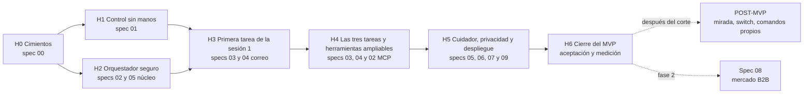

# Orden de construcción

Cómo construir Coalsense Dispatch: hitos, el corte del MVP y la ruta crítica. Los IDs de tareas apuntan a los `tasks.md` de cada spec. El orden fino de dependencias de cada tarea está en el bloque «Orden de dependencias» de su `tasks.md`.

## 1. Tamaño del trabajo

| Spec | Requisitos | Tareas | `[CODEX]` | `[UI]` | `[POST-MVP]` |
| --- | --- | --- | --- | --- | --- |
| 00 Fundaciones | 34 | 17 | 11 | 3 | 0 |
| 01 Capa de entrada | 157 | 57 | 7 | 9 | 5 |
| 02 Orquestador y agentes | 65 | 28 | 5 | 1 | 0 |
| 03 Ciclo de control | 45 | 17 | 2 | 6 | 0 |
| 04 Espacio de trabajo | 39 | 16 | 4 | 3 | 0 |
| 05 Seguridad y bienestar | 38 | 13 | 2 | 2 | 0 |
| 06 Cuidador y perfiles | 33 | 12 | 1 | 3 | 0 |
| 07 Privacidad y datos | 41 | 15 | 1 | 1 | 0 |
| 08 Mercado B2B (fase 2) | 30 | sin tareas | n/a | n/a | n/a |
| 09 Despliegue | 36 | 15 | 3 | 1 | 0 |
| **Total** | **518** | **190** | **36** | **29** | **5** |

Las tareas del MVP son **185** (190 menos las 5 `[POST-MVP]`). Los 488 requisitos del MVP tienen al menos una tarea y una prueba (`TRAZABILIDAD.md`).

## 2. Hitos

### H0. Cimientos (spec 00)

**Objetivo:** que ninguna tarea posterior pueda romper la vertical sin que la CI lo note.

| Ola | Tareas |
| --- | --- |
| 1 | T-00-001 |
| 2 | T-00-002, T-00-003, T-00-004, T-00-005, T-00-006, T-00-007, T-00-009, T-00-013 |
| 3 | T-00-008, T-00-010, T-00-014, T-00-016 |
| 4 | T-00-011, T-00-012, T-00-015, T-00-017 |

**Puerta de salida:** CI en verde con todas las auditorías; autenticación sin contraseña funcionando; componentes base con axe-core y la regla de 44×44 px.

### H1. Control sin manos (spec 01)

**Objetivo:** que una persona controle el PC con voz y con cabeza y gestos, y que Alto y Deshacer siempre funcionen.

| Sub-hito | Tareas |
| --- | --- |
| H1a Núcleo y Alto | T-01-001 a T-01-012, T-01-013, T-01-014 |
| H1b Voz | T-01-018 a T-01-026 |
| H1c Cabeza y gestos | T-01-027 a T-01-031 |
| H1d Teclado, mouse y actuador | T-01-032 a T-01-036 |
| H1e Calibración y privacidad | T-01-037 a T-01-046 |
| H1f Perfiles y resiliencia | T-01-015, T-01-016, T-01-017, T-01-054, T-01-055, T-01-056 |
| H1g Medición | T-01-047, T-01-048, T-01-049 |

**Riesgo a resolver primero:** la latencia de la voz en hardware real. Hacer T-01-021 y T-01-022 (reconocedor de comandos y palabras de control) **antes** que el resto de la voz, con un benchmark temprano de T-01-047, y decidir el motor con datos (PA-10).

**Puerta de salida:** con fixtures, la propiedad «Alto siempre detiene» pasa; ningún cuadro, audio ni landmark sale del dispositivo (captura de red); una calibración completa produce un perfil guardado con Alto y Deshacer practicados.

### H2. Orquestador seguro (spec 02 y núcleo de la spec 05)

**Objetivo:** que ninguna acción con efecto externo ocurra sin aprobación, y que la crisis llegue siempre a una persona.

| Ola | Tareas |
| --- | --- |
| 1 | T-02-001, T-02-002 |
| 2 | T-02-003, T-02-006, T-02-010, T-05-001 |
| 3 | T-02-004, T-02-007, T-02-008, T-02-011, T-02-017, T-05-002, T-05-006, T-05-009, T-05-011 |
| 4 | T-02-009, T-02-012, T-02-013, T-02-014, T-02-016, T-02-019, T-05-003, T-05-004, T-05-010 |
| 5 | T-02-015, T-02-018, T-02-020, T-05-007, T-05-012 |

**Puerta de salida:** sin sello válido la herramienta externa se rechaza; un sello solo sirve para su contenido y una vez; Alto cancela durante la retención; un corpus de crisis llega al 100% a la ruta humana sin red y sin modelo; el constructor de prompts rechaza el perfil y la condición declarada.

### H3. Primera tarea de la sesión 1 (spec 03 y correo de la spec 04)

**Objetivo:** de la calibración a la primera tarea completada, en la misma sesión. Es el primer corte demostrable de la vertical.

| Ola | Tareas |
| --- | --- |
| 1 | T-03-001, T-04-001, T-04-003 |
| 2 | T-03-002, T-03-005, T-04-002, T-04-004, T-04-005 |
| 3 | T-03-003, T-03-004, T-03-006, T-03-007, T-04-006 |
| 4 | T-03-011, T-03-015, T-05-005, T-05-008 |

**Puerta de salida:** una persona de ejemplo con voz y cabeza completa la calibración y la primera tarea (correo a sí misma con aprobación) y ve su primer logro. REQ-03-040 a REQ-03-044.

### H4. Las tres tareas y herramientas ampliables

| Ola | Tareas |
| --- | --- |
| 1 | T-04-007, T-04-009, T-03-009, T-02-021, T-02-022 |
| 2 | T-04-008, T-04-010, T-04-011, T-03-010, T-03-012, T-03-013, T-03-014, T-02-023 |
| 3 | T-02-024, T-04-012, T-02-025 |

**Puerta de salida:** las tres tareas funcionan de punta a punta con aprobación; habilitar una herramienta MCP exige la aprobación de la persona; el conjunto de inyección de prompts pasa.

### H5. Cuidador, privacidad y despliegue

| Spec | Tareas |
| --- | --- |
| 06 | T-06-001 a T-06-012 |
| 07 | T-07-001 a T-07-015 |
| 09 | T-09-001 a T-09-015 |
| Resto de 02, 03, 04, 05 | T-02-004, T-02-005, T-02-026, T-02-027, T-03-008, T-03-017, T-04-013 a T-04-016, T-05-013 |

**Puerta de salida:** una persona borra todos sus datos y el contenido queda ilegible incluso en una copia restaurada; el cuidador/a no aprueba sin delegación vigente; el instalador firmado y el entorno de prueba funcionan; el empaquetado no abre destinos de red nuevos.

### H6. Cierre del MVP

| Tarea | Para qué |
| --- | --- |
| T-01-047, T-01-049, T-02-028, T-04-014, T-05-013, T-09-015 | Medir en el hardware real y reemplazar los valores `[SUPUESTO]` |
| T-01-048, T-03-016, T-04-013, T-06-012 | Suites de accesibilidad completas |
| T-00-006 | Trazabilidad y glosario en verde sobre todo `.kiro/specs/` |

## 3. Corte del MVP

**Dentro:** todas las tareas **sin** `[POST-MVP]` de las specs 00 a 07 y 09. Es decir, calibración que termina con la primera tarea, control de la app y del PC por voz y por cabeza y gestos, tres tipos de tarea con aprobación, registro de logros, protocolo de crisis y panel básico del cuidador, más la extensión por herramientas MCP del catálogo curado.

**Fuera, después del corte:**

| Qué | Tareas | Por qué |
| --- | --- | --- |
| Mirada con dwell | T-01-050, T-01-051 | El alcance del MVP es voz y cabeza/gestos (PA-07) |
| Switch con escaneo | T-01-052, T-01-053 | Idem |
| Comandos y alias propios | T-01-057 | No es necesario para el ciclo de control |
| Sincronización del perfil de capacidad | sin tarea | Se mantiene solo en el dispositivo (S-11) |
| Mercado B2B y pagos | spec 08 | Fase 2 |
| App Android | sin spec | Fase 2 |
| Habla atípica | sin spec | Fase 3 |

**Definición de MVP terminado**

1. Una persona de ejemplo con voz y cabeza completa la calibración y la primera tarea en la sesión 1 (REQ-03-040).
2. Las tres tareas del MVP funcionan de punta a punta con aprobación.
3. Se cumplen las propiedades SP-1 a SP-7 y las propiedades de cada spec (tablas «Propiedades de corrección» de los `design.md`).
4. Las suites de accesibilidad pasan: WCAG 2.2 AA, 44×44 px y ningún límite de tiempo.
5. `TRAZABILIDAD.md` sin huérfanos y el glosario sin términos prohibidos.
6. Presupuestos de latencia y recursos medidos en hardware real y actualizados.
7. La derivación de crisis funciona de extremo a extremo en el entorno de prueba con destinatarios ficticios.
8. `THIRD_PARTY.md` completo y la auditoría de licencias en verde.

## 4. Puerta de lanzamiento a personas reales

Terminar el MVP **no** autoriza ofrecerlo a personas reales. Antes (`safety.md` SF-06):

- Al menos una ruta humana configurada y probada; el operador define la línea de ayuda oficial cuando corresponda (C-06).
- Reglas y mensajes de crisis revisados por un profesional de salud mental (`reviewed_by` completo).
- Revisión legal bajo LOPDP, incluida la regulación de apps de salud mental con IA, la transferencia internacional de datos y la representación legal (PA-12, PA-18, PA-25).
- Consentimiento informado por escrito.
- Estrategia de licencias resuelta para Piper y n8n (PA-09).
- Hosting y región definidos (PA-18).

## 5. Ruta crítica y riesgos

| # | Riesgo | Efecto | Qué hacer |
| --- | --- | --- | --- |
| 1 | Latencia de voz en CPU de gama media | Incumple los presupuestos de Alto y comandos | Benchmark temprano en T-01-047; motor alterno para comandos (PA-10) |
| 2 | Cobertura de UI Automation en aplicaciones Chromium y Electron | Los números en pantalla fallan | Cuadrícula como respaldo (T-01-035) |
| 3 | Licencias de Piper y n8n | Bloquea voz sintética o acciones deterministas | Voz del sistema por defecto; n8n opcional (PA-09) |
| 4 | Revisión profesional de las reglas de crisis | Bloquea el lanzamiento, no la construcción | Empezar con reglas marcadas `reviewed_by: pendiente` |
| 5 | Proveedores de modelo y consentimiento por proveedor | El respaldo puede quedar sin consentimiento | Pausar con aviso (REQ-02-004) |
| 6 | Inyección de prompts desde correos y documentos | Efectos externos no deseados | El sello y la tarjeta con el contenido exacto acotan el daño (T-02-024) |

**Ruta crítica:** T-00-001 → T-01-001 → T-01-003 → T-01-009 → T-01-021/022 → T-01-040 (calibración) → T-03-015 (primera tarea). En paralelo: T-02-002 → T-02-010 → T-02-011 → T-02-007 → T-04-006 (envío con aprobación).

## 6. Cómo paralelizar la construcción

- **Misma ola, sin dependencias entre sí:** pueden construirse a la vez. No ejecutes en paralelo dos tareas que modifican el mismo archivo.
- **`[CODEX]`:** tareas acotadas, con prueba propia y sin decisiones de producto. Se pueden dar a Codex en paralelo.
- **`[UI]`:** se resuelven con las skills de diseño y siempre subordinadas a `.kiro/steering/accessibility.md`. Una tarea de interfaz no está terminada hasta pasar axe-core, la regla de 44×44 px y el recorrido solo con teclado e intenciones simuladas.
- **Interfaces simuladas entre hitos:** donde una tarea necesita un servicio que se construye después (`ConsentChecker`, `DelegationLookup`, `DerivationReceiver`), usa una implementación simulada que **niega por defecto**; la real llega con su tarea.
- **Dependencias externas de la spec 01:** las tareas `T-01-xxx` que dependen de `T-00-xxx` usan el monorepo y los componentes de la spec 00; construir H0 primero evita rehacer.

## 7. Por dónde empezar

1. T-00-001 (monorepo).
2. T-00-002 a T-00-007, T-00-009 y T-00-013 en paralelo.
3. T-01-001 y T-01-002 (esquema de intenciones y generación de tipos).
4. T-01-003 (bus) y T-02-001 / T-02-002 (API y persistencia) en paralelo.
5. T-01-009 (StopGuard) y T-01-021 (palabras de control): lo más importante de la vertical y el mayor riesgo técnico.
