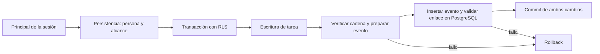

# Bitácora encadenada por persona

Avance de T-02-003. La persistencia de tareas ya usa esta bitácora. Todavía faltan
ejecutores, políticas, fusiones del companion, lectura por API y pantalla legible
para cubrir todos los requisitos de la spec 02. No se cierran tareas ni hitos.

## Qué se registra

`AuditDraft` admite un tipo y un resultado de listas cerradas, y referencias
estructuradas. Los tipos cubren creación y pausa de tareas, plan, paso, herramienta,
política, aprobación, Alto, Deshacer, derivación y acceso. Las referencias solo
admiten identificadores UUID, nombre de herramienta, clase de efecto, origen de
actor y versión de política. El nombre de herramienta reutiliza el validador del
contrato compartido de manifiestos.

No hay campos de texto libre de tarea, destinatario, archivo, perfil, condición
declarada ni mensaje de crisis. Las claves desconocidas y los tipos incorrectos
se rechazan. La base también comprueba las claves y tipos de referencias. La forma
cerrada no sustituye la procedencia de los metadatos: los genera código del servidor,
no una salida de modelo ni una solicitud de cliente. Las entradas de bitácora no
constituyen sellos de aprobación.

## Escritura

El servicio establece la persona dentro de una transacción. `append_event` exige
esa transacción y el mismo ámbito, toma un bloqueo por persona, verifica el historial
completo y agrega el siguiente evento. El trigger repite la comprobación de secuencia
y enlace para inserciones SQL. Una clave foránea compuesta impide enlazar una tarea
de otra persona. Las escrituras concurrentes de una persona se serializan.

El rol de ejecución carece de UPDATE, DELETE y TRUNCATE sobre `audit_event`. RLS se
aplica también al propietario. El rol de auditoría operativa no recibe lectura de
eventos individuales. Crear o pausar falla y revierte la tarea si la bitácora falla.

Para consumidores del servidor, `PersistenceService.append_audit` devuelve el evento
después del commit. El futuro gateway debe esperar ese resultado y propagar sus
fallos antes de un efecto externo. El ejecutor interno ya espera el registro del
intento y el servicio de aprobaciones espera el suyo antes de emitir el sello.
El despacho se prueba con un adaptador simulado. La conexión de producción y la
verificación completa de SP-1 y REQ-02-053 siguen pendientes.

## Formato de huella

La versión 1 usa SHA-256 de campos en orden fijo, una línea ASCII por campo,
prefijo `coalsense.audit.v1`, fecha UTC con seis decimales, referencias ausentes
representadas por `-` y la huella anterior. Los valores admitidos no contienen
saltos de línea. La primera huella anterior contiene 64 ceros. Se vinculan persona,
identificador, secuencia, fecha, tipo, resultado y todas las referencias.

`0004_policy.sql` añade el formato 2 con prefijo `coalsense.audit.v2` y referencias
cerradas `action_id` y `rule_id`, después de las referencias v1 y antes de la huella
anterior. Cada registro declara su formato; ambos pueden alternarse en una cadena.
No se recalculan huellas históricas. El escritor actualizado declara v2; el valor
SQL por defecto conserva v1 para escritores anteriores. La prueba de actualización
conserva un registro previo y agrega v2 y otro v1 después de migrar, verificando
los tres enlaces.

Python y PostgreSQL calculan la misma huella; un CHECK de la tabla valida cada
inserción. Las pruebas ejercitan todos los campos de referencia, además de la
conversión de eventos anteriores. Se conservan sus identificadores, instantes y
persona, y la tabla histórica queda sin permiso de inserción para la aplicación.

El verificador detecta cambios, reordenación, huecos y mezcla de personas. Una
cabecera conocida permite detectar que se ha quitado el final. Sin una referencia
confiable fuera de la base, un prefijo válido por sí solo no demuestra que el final
esté completo. Tampoco se acredita resistencia a una reescritura privilegiada que
recalcule toda la cadena. No hay todavía un servicio de anclaje externo.

## Verificación y límites

Las pruebas reales comprueban permisos, RLS, concurrencia, coincidencia de huellas,
rechazo de campos de contenido en SQL, secuencias falsas, corrupción privilegiada,
revocación del permiso de INSERT, rollback de tarea y conversión transaccional.
Las pruebas de corrupción modifican y restauran únicamente su base sintética.

Por ahora verificar antes de extender cuesta tiempo lineal respecto al historial
de la persona. Falta medir el volumen real y diseñar una optimización que conserve
la evidencia. El Alto local del companion permanece independiente de PostgreSQL.

Los eventos existentes de autenticación aún usan su repositorio en memoria. Tampoco
se registran automáticamente acciones de componentes que no se han construido.
Faltan adaptadores para esos consumidores, delegaciones y lectura con filtros,
fusión idempotente, API, pantalla y exportación, cifrado de datos especiales y el
inventario completo de datos, además de revisiones humanas y cruzadas. La web
continúa usando sus datos locales y no presenta este historial como conectado.

El motor interno de políticas ya espera el registro confirmado de sus evaluaciones.
Activar una versión también registra en la misma transacción; un fallo revierte la
activación. El alcance y los límites se describen en `POLITICAS.md`.
